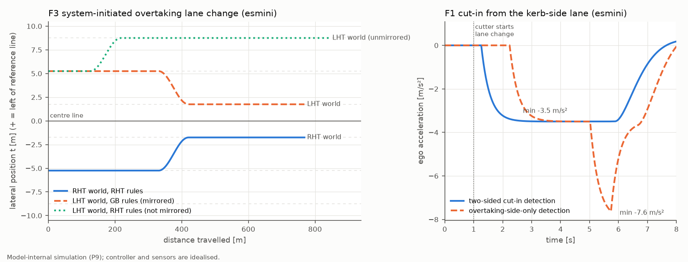

# 海外智驾本地化可行性分析：欧盟、英国、澳大利亚与东盟

作者：罗文杰｜2026-10｜个人项目，在 AI 编码助手（Claude）辅助下完成。

> **写作规则**
> - 事实只来自官方文本，并标出 `regulation_matrix.csv`、`lht_deltas.csv` 的行号或 `data/sources.csv` 的来源号（S..）。
> - 查不到的写「未核实」；我自己的推断标【推论】。
> - 计算器与仿真的数字都由脚本生成，表格由 `scripts/sync_report.py` 从 `results/tables.md` 同步过来，不手改。
> - 仿真结论只在本模型内成立。本项目**不声称**任何车辆或功能符合任何法规或评级规程。

## 0 摘要

- **做了什么**
  - 一套已有的 ADAS / L2 功能要进入欧盟、英国、澳大利亚、马来西亚、泰国、印尼六个市场。本项目先把各市场的法规与评级要求整理成 88 行矩阵（71 行已核实），每行带文件、条款和来源。
  - 再列出 10 项左行 / 右舵和本地环境差异，写明受影响功能、改动类型和验证方法。
  - 计算器从功能需求推导探测距离、视场和时延，比较 1V1R、5R1V、11V5R1L 三套方案。
  - esmini 里跑了一组右行 / 左行镜像场景，用来检查哪些逻辑必须镜像。
  - 最后汇总成 23 行的 SOR 式需求差异表。
- **英国不适用欧盟 GSR2，但已决定跟进**（GB-01、GB-02）。
  - DfT 2026-07-16 决定强制 18 项技术，技术依据就是欧盟和 UNECE 文件；新车型在生效日后 12 个月、新注册在 24 个月后执行。
  - 法律文本（SI）尚未提交，北爱尔兰按欧盟规则（GB-11）。
  - 【推论】功能内容可沿用欧盟版本，要单独做的是 ISA 的英国路牌与 mph（GB-05、GB-12、GB-13、D-04）。
- **澳大利亚已对所有新车强制 AEB 车对车与行人**（ADR 98/01，2026-08-01，AU-01）。
  - 骑行者 AEB 与 ELKS（UN R178）2028-03-01 起对新车型强制（AU-02、AU-04）。
  - ANCAP 要求限速辅助按澳新路牌调校，复用 Euro NCAP 结果时也要重做本地限速试验（AU-15、AU-17）。
- **东盟三国的型式认证都不强制 AEB，推动力是 ASEAN NCAP**（MY-01、TH-02、ID-01、AN-01）。
  - 摩托车相关分值大：AEB 车对摩托车 6 分、盲区 8 分（AN-03、AN-05）。
  - 泰国不在 UN R79 的适用方名单中，但适用 R171（TH-04）；印尼不是 1958 协定缔约方（ID-01）。
- **计算器**
  - 1V1R 满足全部 6 条 AEB 距离需求（暴雨 50 mm/h 下最小余量 58.0 m），但没有后向覆盖，变道与盲区共 10 条需求不满足。
  - 5R1V 晴天满足 23/25；最先失效的是「来车未持续跟踪」时的变道后向需求 73.8 m：50 mm/h 暴雨下角雷达有效距离降到 68.9 m。
  - 130 km/h 用 ACC 舒适减速度对静止车停住需要 349.1 m，三套方案都不够。
- **镜像仿真**（模型内）
  - 规则集与世界匹配时，8 组右行 / 左行运行逐点一致。
  - 左行世界用右行规则时，系统发起的超车变道变到路缘侧并从内侧超越前车；只看超车侧的切入检测对路缘侧切入晚 0.98 s 响应，最小间距从 14.21 m 降到 5.77 m。

## 1 目标与范围

- **功能集**（M1 乘用车）
  - AEB：车对车、行人与骑行者、摩托车；
  - 车道支持与 ELKS；ISA / 限速辅助；DDAW、ADDW 与驾驶员监测；EDR；
  - ACC；L2 车道居中与变道（UN R79 ACSF、UN R171 DCAS）；盲区监测。
- **市场**：欧盟（作为基线）、英国（大不列颠，GB）、澳大利亚、马来西亚、泰国、印尼。
- **不在范围**：认证判定；网络安全与 OTA；座舱语音；重型车。重型车项目只在需要说明时列出。
- **与前面几个项目的关系**
  - P2 已核实 46 条欧盟、UNECE、马来西亚与 ASEAN NCAP 要求。本项目直接引用这些行（矩阵的「复用」列），新增英国、澳大利亚、泰国、印尼，以及 UNECE 中与本地化有关的条款（R79 变道、R171 交通规则与变道、R178）。
  - P5 的湿路 AEB 结果是模型内证据，用于降雨差异（D-07）。
  - P7 的 DMS 测试框架用于右舵镜像（D-08）。

## 2 方法与来源

### 2.1 来源与核实规则

| 类别 | 来源 | 读取方式 |
|---|---|---|
| 欧盟与 UNECE | GSR2、实施细则（P2 已读）；UN R79 03 系列、R171 00 系列、R39 02 系列在欧盟官方公报中的转载文本 | EUR-Lex 对抓取工具返回空页，改用欧盟出版局 Cellar 接口按 CELEX 号取同一份官方文本（S11、S12、S18） |
| 条约 | UN 条约库 1958 协定参加方与各法规适用方 | 逐页读取（S13–S22） |
| 英国 | DfT 咨询文件与政府答复、VCA 技术指南与 FAQ、The Highway Code | gov.uk 页面（S30–S37）；legislation.gov.uk 对抓取返回空页，SI 原文未读 |
| 澳大利亚 | ADR 原文（Federal Register of Legislation）、ANCAP 2026–2028 规程、Australian Road Rules | PDF（S40–S54） |
| 欧洲评级 | Euro NCAP 2026 规程（P5、P7 已读部分；Vehicle Assistance v1.2） | 网页（S84）；Vehicle Assistance 的 PDF 由 WebFetch 自动缓存，本项目用 pdfplumber 读取（S87） |
| 东盟 | ASEAN NCAP 规程（P2 已读，本项目复核摩托车规程）、JPJ 报告、泰国政府公报、印尼法律数据库、WHO 国家概况 | PDF（S60–S74） |
| 计算器 | ITU-R P.838-3；厂商产品页（Hesai、Bosch） | PDF 与网页（S80–S83） |

- **核实状态**
  - **已核实**：在官方文本中看到了该条款。
  - **部分核实**：看到官方来源，但没看到条款原文，或只看到标题、检索摘要。
  - **未核实**：只有二手来源，或没有找到。
  - 「未见要求」只代表所查文件中没有，不等于不存在。
- **检索方式**
  - 英国、澳大利亚、东盟三部分由三个检索子任务分头读取官方文本，记录条款和原文摘录。
  - 三条最关键的结论由本项目再次打开官方页面复核：
    - DfT 的决定原文、18 项清单与时间表（S31）；
    - 泰国不在 R79 的 43 个适用方之中（S20）；
    - UN R178 的生效日期与适用方（S13）。

### 2.2 计算器（`feasib/`）

- **AEB**
  - 需求距离 = 相对速度 ×（感知 + 确认 + FCW 提前量 + 执行时延）+ 相对速度² ÷（2 × 减速度）+ 停车余量。
  - FCW 提前量 0.8 s 取自 R152 §5.2.1.1。减速度为 5.0 m/s²（R152 §5.2.1.2 的最低制动需求）或 6.0 m/s²（假设 A-04）。
  - 反过来，给定方案的最远探测距离，可以算出还能容忍的总时延。
- **ACC**
  - 需求距离 = 相对速度 × 时延 + 相对速度² ÷（2 × 舒适减速度）+ 终端间距。终端间距为前车车速 × 时距，或停车间距。
  - 英国按 Highway Code 规则 126：至少 2 s，湿路至少加倍。
- **变道后向间隙**
  - R171 §6.2.4.1：来车在变道开始 A 秒后以不超过 3 m/s² 减速，两车间距始终不小于本车 1 s 行程。由此得出起始间距需求：
    S = Δv·A + Δv²/(2·3) + v_本车·1 s
  - 这与 R79 §5.6.4.7 的临界距离公式结构相同（tB = A = 0.4 s）。
  - 未检测到来车时，按 §6.2.4.2 假设来车在后向探测距离处，车速取法定最高车速或 130 km/h 中的较小者；驾驶员确认的变道按 §6.2.9.1.2 取最高车速 +10 %。
  - R79 的最低变道车速 V_smin 在官方公报 HTML 中是图片，本项目按 §5.6.4.7 解二次方程自行推导，并用单元测试验证它是临界距离的反函数。
- **切入视场**
  - 按几何关系计算从前保险杠看目标近侧边缘的方位角。
  - 横移时间：轿车按近侧边缘到车道线计，摩托车按近侧边缘到本车路径（半车宽）计，横向速度 1.0 m/s（假设 A-07、A-08）。
- **传感器模型**
  - 每个传感器是若干「波瓣」（距离 × 半角）。一个点落在某波瓣的角度内、且距离不超过该波瓣的有效距离，就算覆盖。
  - 盲区摩托车按 2 m 长的目标处理，车身任一点被看到即算检出。
- **降雨**
  - 雷达：用 ITU-R P.838-3 Table 5 的 77 GHz 系数（水平极化 k = 1.1320、α = 0.7177）算比衰减 γ = k·R^α（dB/km）。双程路径损耗加上可选的雷达罩水膜损耗（A-12），代入雷达方程（距离四次方）迭代求有效距离。
  - 激光雷达（A-13）和摄像头（A-14）的系数是假设，没有引用来源。
- **成本**：只给相对档位，按 A-20 的规则计算（1 + [雷达 ≥ 5] + [摄像头 ≥ 5] + [有激光雷达]），不给价格。

### 2.3 镜像仿真（`sim/`）

- **场景**
  - 一份与交通侧无关的场景描述，车道按「从中线数第几条」命名：1 = 超车道，2 = 中间车道，3 = 路缘侧车道。
  - 写成两套文件：
    - 右行：`rule="RHT"`，本方向用车道 −1/−2/−3；
    - 左行：`rule="LHT"`，本方向用车道 +1/+2/+3。
  - 两个世界都沿 +x 行驶，左行世界就是右行世界关于参考线的镜像。
  - 先用一个小场景确认了 esmini v3.10.2 支持 `rule="LHT"`：左行道路上 +2 车道的车沿 +s 行驶，−2 车道的车沿 −s 行驶。
- **运行方式**
  - esmini 通过 esminiLib（ctypes）无界面运行，步长 0.02 s。目标车由 storyboard 驱动（定速、换道、减速），自车交给 ExternalController，由 Python 控制器闭环。接法沿用 P5，改为多目标并上报自车横向位置。
  - 另写纯 Python 后端，按同一份场景描述重新积分目标车运动，用来交叉验证。
- **控制器**
  - 所有与侧别有关的逻辑只经过一个参数「超车侧」：+1 表示超车道在车辆左侧（右行），−1 表示在右侧（左行）。
  - 「未镜像」配置就是在左行世界里用右行规则集。
  - 功能包括：ACC、切入检测（两侧对称，或只看超车侧）、「不得内侧超车」约束、系统发起的超车变道。变道部分实现了 R171 的打灯 3 s、后向间隙检查、7 s 未开始即取消，横向加速度峰值 1.08 m/s²，低于 §6.2.3 的 1.5 m/s²。
- **规则集**（RULESETS）
  - RHT_BASE：项目假设，与英国规则对称；
  - GB：Highway Code 规则 264、268；
  - AU：Australian Road Rules 规则 141(1)(a)，多车道标线车道允许从左侧超越；
  - ID：UU 22/2009 Pasal 109。

## 3 法规与评级矩阵

<!-- AUTO:表 1 -->
状态简写：强制 = 已对新车生效；已立法 = 法规已发布但日期未到；已决定待立法 = 政府已决定、法律文本未出；接受 UN 认证 = 1958 协定下接受按该法规颁发的认证，不等于强制装配；未见要求 = 仅限所查文件。括号内为关键日期。

| 功能 | EU | GB | AU | MY | TH | ID |
|---|---|---|---|---|---|---|
| AEB 车对车 | 强制（2024-07-07） EU-01 评级（2026） EU-12 | 已决定待立法（EiF+12/24 个月） GB-03 | 强制（2026-08-01） AU-01 评级（2026–2028） AU-13 | 未见要求 MY-01 评级（2026） AN-01 | 接受 UN 认证（2020-01-22） TH-02 评级（2026） AN-01 | 未见要求 ID-04 评级（2026） AN-01 |
| AEB 行人/骑行者 | 强制（2026-07-07） EU-02 未核实 EU-13 | 已决定待立法（EiF+12/24 个月） GB-03 | 强制（2026-08-01） AU-01 已立法（2028-03-01） AU-02 评级（2026–2028） AU-13 | 未见要求 MY-01 评级（2026） AN-02 | 接受 UN 认证（2020-01-22） TH-02 评级（2026） AN-02 | 未见要求 ID-04 评级（2026） AN-02 |
| AEB 摩托车 | 未见要求 EU-03 未核实 EU-13 | — | 未见要求 AU-03 评级（2026–2028） AU-13 | 评级（2024-05） AN-03 | 评级（2024-05） AN-03 | 评级（2024-05） AN-03 |
| 车道支持 / ELKS | 强制（2024-07-07） EU-04 | 已决定待立法（EiF+12/24 个月） GB-04 | 已立法（2028-03-01） AU-04 强制（2026-09-01） AU-05 评级（2026–2028） AU-14 | 装配则须合规（2020-07-01） MY-02 评级（2026） AN-04 | 接受 UN 认证（2026-01-11） TH-03 评级（2026） AN-04 | 未见要求 ID-04 评级（2026） AN-04 |
| ISA / 限速 | 强制（2024-07-07） EU-05 评级（2026） EU-14 | 已决定待立法（EiF+12/24 个月） GB-05 评级（2026） GB-13 | 未核实 AU-06 评级（2026–2028） AU-15 | 未见要求 MY-03 评级（2026） AN-06 | 未核实 TH-08 评级（2026） AN-06 | 未见要求 ID-04 评级（2026） AN-06 |
| 疲劳与分心 / DMS | 强制（2024-07-07） EU-06 强制（2026-07-07） EU-07 评级（2026） EU-15 | 已决定待立法（EiF+12/24 个月） GB-06 | 未核实 AU-07 评级（2026–2028） AU-16 | 未见要求 MY-03 评级（2026） AN-07 | 未核实 TH-08 评级（2026） AN-07 | 未见要求 ID-04 评级（2026） AN-07 |
| EDR | 强制（2024-07-07） EU-08 | 已决定待立法（EiF+36 个月） GB-07 | 未核实 AU-08 | 未见要求 MY-03 | 接受 UN 认证（2021-09-30） TH-05 | 未见要求 ID-04 |
| L2 / 变道 | 装配则须合规 EU-11 | 未核实 GB-09 | 未核实 AU-09 | 接受 UN 认证（2024-09-22） MY-04 | 接受 UN 认证（2024-09-22） TH-04 | 未加入 1958 协定 ID-01 未见要求 ID-04 |
| 盲区 | 未见要求 EU-10 | — | 评级（2026–2028） AU-14 | 评级（2024-05） AN-05 | 评级（2024-05） AN-05 | 评级（2024-05） AN-05 |
| 倒车检测 | 强制（2024-07-07） EU-09 | 已决定待立法（EiF+12/24 个月） GB-08 | 强制（2027-11-01） AU-10 | 未见要求 MY-07 | — | — |
| 重型车 AEB | — | — | 强制（2025-02-01） AU-11 | 装配则须合规（2020-07-01） MY-05 | 接受 UN 认证（2013-07-09） TH-07 | — |
| 总体与认证路径 | — | 未见要求 GB-01 已决定待立法（EiF+12/24 个月） GB-02 强制（2026-02-01） GB-10 强制 GB-11 强制 GB-12 评级（2026） GB-13 | 接受 UN 认证（2000-02-25） AU-12 评级（2026–2028） AU-17 | 接受 UN 认证（2006-02-03） MY-06 背景（2024-05） AN-08 评级 AN-09 | 接受 UN 认证（2006-03-02） TH-01 未核实（2026-01-01） TH-06 背景（2024-05） AN-08 评级 AN-09 | 未加入 1958 协定 ID-01 强制（2009） ID-02 未核实 ID-03 背景（2024-05） AN-08 评级 AN-09 |
<!-- /AUTO -->

### 3.1 欧盟（基线）

- **GSR2 Annex II**（P2 已核实）：
  - AEB 车对车、ELKS、ISA、DDAW、EDR、倒车检测为代码 B，2024-07-07 起所有新车（EU-01、EU-04–EU-06、EU-08、EU-09）；
  - AEB 行人/骑行者与 ADDW 为代码 C，2026-07-07 起所有新车（EU-02、EU-07）。截至本文日期，两个日期都已过。
- **评级**
  - Euro NCAP 2026 的追尾网格到 130 km/h（EU-12，P5 已逐格核对）。
  - 限速信息准确率在 Euro NCAP 指定的路线上测：至少 2,000 km，覆盖 3–5 个国家。条件、隐含、动态限速须在包括英国在内的 10 国至少 80 % 时间可用（EU-14，Vehicle Assistance v1.2 §1.2.1–1.2.2）。
- **UN R178**（ELKS）2026-01-11 生效，欧盟同日起适用（S13）。GSR 是否改为引用 R178：未核实。

### 3.2 英国

- **现状**
  - GSR2 在英国脱欧后才实施，不属于 GB 法律。
  - GB 型式认证只认 VCA 主题表中列出的项目，表中的 AEB（UN R131.01）和 LDWS（UN R130.00）都是重型车项目（GB-01）。
- **决定**：DfT 2026-07-16 的政府答复决定强制 18 项技术（GB-02）。
  - 新 GB 车型在生效日（EiF）后 12 个月执行；新注册的完整车辆在 24 个月后执行（DIV 与 EDR 为 36 个月），多阶段车辆分别为 36、48 个月。
  - SI 尚未提交，EiF 未定。
- **技术依据**（GB-03–GB-08）：
  - AEB 用 UN R152.02；ELKS 用 (EU) 2021/646；ISA 用 2021/1958，只作提示；
  - DDAW、ADDW 用 2021/1341、2023/2590；EDR 用 R160.01；倒车检测用 R158.00。
  - DfT 文件把 2021/646 写作 Delegated Regulation，欧盟文本标题是 Implementing Regulation（S05），本项目以欧盟文本为准。
- **ISA**
  - 政府答复说将确保系统对英国路牌和标线有可接受的性能（S31）。mph 怎么处理，文件没写（未核实）。
  - Euro NCAP 的条件、隐含、动态限速要求也点名了英国（GB-13）。
- **认证路径**（GB-10）
  - 基于欧盟认证的临时 GB 认证 2025-02-01 起不再受理 M、N、O 类；2026-02-01 起 M、N 类车型须持完整 GB 或 UK(NI) 认证。
  - UN 认证可作为 GB 整车认证的组成部分。
- **北爱尔兰**：在温莎框架下适用欧盟型式认证规则，含 GSR2（GB-11）。
- **车速表**：UN R39 §5.2.2 规定，在使用英制单位的国家销售的 M、N 类车，车速表须同时标 mph（GB-12）。
- 【推论】英国版本的功能内容与欧盟相同，差异集中在数据与认证文件：ISA 的英国路牌、单位，以及 GB 认证文件包。

### 3.3 澳大利亚

- **AEB**
  - ADR 98/00（AEB 车对车）新车型 2023-03-01、所有新车 2025-03-01 起（S40）。
  - ADR 98/01 加入车对行人，新车型 2024-08-01、所有新车 2026-08-01 起（AU-01）。
  - ADR 98/02 加入自行车，Appendix A 为 UN R152/02 至 Supplement 5（含 Annex 4 虚拟测试），新车型 2028-03-01、所有新车 2029-03-01 起（AU-02）。
  - 三个版本都没有摩托车场景（AU-03）。
- **ELKS**：ADR 107/00 的 Appendix A 为 UN R178/00，车道线识别按 R130/01 Annex 3 理解，新车型 2028-03-01 起（AU-04）。
- **倒车**：ADR 108/00 对乘用车也适用，所有新车 2027-11-01 起（AU-10）。
- **重型车**：ADR 97/00、99/01、105/00 只适用于重型车（AU-05、AU-11）。
  - 其中 99/01 要求 LDW 在 Appendix C 列出的全部澳大利亚车道线上工作。【推论】这说明澳大利亚监管方把「本地车道线」当作需要专门验证的项目。
- **接受 UN 认证的方式**：每份 ADR 第 7 条逐条列出可替代的 UN 法规及系列，没有统一条款（AU-12）。例如 98/01 接受 R152 00 或 01 系列。
- **未查到**：ISA、DDAW/ADDW、EDR 与 L2 的 ADR（AU-06–AU-09，未核实，不能证明不存在）。UN 条约库显示澳大利亚自 2024-12-24 适用 R79（S20）。
- **ANCAP 2026–2028**
  - 追尾以外还有对向、转弯穿越（CCFtap、CMFtap）和交叉场景（AU-13）。
  - 车道支持含路沿、对向、超车与盲区监测，试验车道线按 UN R130（AU-14）。
  - 限速辅助 20 分：在 ANCAP 选定的公共道路上跑至少 200 km，含 12 种学区标志；需要为澳新路牌调校时可申请「调校期」（AU-15）。
  - 各规程第 2 页写明插图按欧洲左舵布置、凡相关须按右舵调整，近侧与远侧对右舵车互换。复用 Euro NCAP 结果时，必须重做区域特定系统（点名限速信息）的试验（AU-17）。

### 3.4 马来西亚、泰国、印尼

- **马来西亚**（P2 已核实）
  - UN R152 列为 VTA「未来实施」（MY-01）；装 LDWS 须符合 R130（MY-02）。
  - ISA、DMS、EDR 不在 JPJ 清单中（MY-03）。
  - 适用 R79、R171（MY-04），即接受按这两项法规颁发的认证，不等于强制装配。
- **泰国**
  - 2006-03-02 加入 1958 协定（TH-01）。
  - 适用 R152（2020-01-22）、R130 与 R131（2013-07-09）、R160（2021-09-30）、R171（2024-09-22）、R178（2026-01-11），但**不在 R79 的适用方名单中**（TH-02–TH-05、TH-07；S20 逐项核对 43 个适用方）。【推论】按 R79 取得的 L2 认证在泰国不能按 1958 协定自动互认，L2 宜按 R171 认证；泰国本国的要求仍待向当地机构确认。
  - 消费税：部令第 23 号规定，2026 年起乘用车按 CO2 分档的低税率以「符合消费税厅长公告的条件」为前提（TH-06）。2025 年底前的档位明文要求 Active Safety 标准；2026 年的厅长条件没有查到原文，新闻称为「6 项 ADAS 至少装 2 项」（未核实）。电动皮卡同类公告列出的 6 项是 AEB、FCW、LKAS、LDW、BSD、ACC，有效期到 2025-12-31（S66）。
  - 没有查到 TISI 或 DLT 强制装配 ADAS 的规定（TH-08，未核实）。
- **印尼**
  - 不是 1958 协定缔约方，不适用 R79、R130、R131、R152、R157、R160、R171（ID-01）。
  - UU 22/2009 规定所有机动车须做国家型式试验，适航项目清单中没有 ADAS（ID-02）。实施细则 PM 33/2018 的正文未能读取（ID-03）。
- **ASEAN NCAP**（三国同属 Sector 1）
  - AEB 车对车 7.5 分（AN-01）；AEB 行人为 Advanced SAT（AN-02）。
  - AEB 车对摩托车 6 分：AEB 计分到 60 km/h，FCW 到 80 km/h（AN-03，本项目复核了 Table 5）。
  - 盲区技术 8 分：驾驶员侧、乘客侧各 4 分，摩托车横向 2–3 m 须检出、6.0 m 不得检出（AN-05）。
  - 规程指出东盟地区摩托车在左右车道行驶并自由并线、超车（AN-08）。
- **东盟型式认证互认安排**（2021）：本项目只读到非官方文本，其中附件包含 R79，但不含 R130、R131、R152、R171（S70，未核实）。

### 3.5 UNECE 技术条款

<!-- AUTO:表 2 -->
| 编号 | 内容 | 条款 | 核实 |
|---|---|---|---|
| UN-01 | 车对车 10–60 km/h；FCW 比紧急制动至少早 0.8 s；制动需求 ≥ 5.0 m/s²；M1 避撞速度表；行人；骑行者（02 系列） | §5.2.1.1–5.2.1.4、§5.2.2、§5.2.3 | 已核实 |
| UN-02 | 驾驶员只能在禁止行人和自行车、对向有物理隔离、同向至少两车道的道路上激活 | §5.6.4.2.3 | 已核实 |
| UN-03 | 变道操作 M1/N1 不超过 5 s（M2、M3、N2、N3 为 10 s） | §5.6.4.6.5 | 已核实 |
| UN-04 | 临界距离 S = (v_rear − v_ACSF)·tB + (v_rear − v_ACSF)²/(2a) + v_ACSF·tG，a = 3 m/s²、tB = 0.4 s、tG = 1 s；申报的后向探测距离 S_rear ≥ 55 m；M1/N1 的 v_app = 36.1 m/s（130 km/h） | §5.6.4.7、§5.6.4.8.1 | 已核实 |
| UN-05 | 脱手 15 s 内视觉警告，30 s 内声音警告，声音警告开始后 30 s 内退出 | §5.6.2 | 已核实 |
| UN-06 | 系统发起的操作须按各国交通规则设计；驾驶员发起时 DCAS 只协助操作、不保证合规；规程承认各国规则差异大，完全合规不一定做得到，靠驾驶员持续参与弥补 | Introduction ¶8–9 | 已核实 |
| UN-07 | 应确定当前车道的法定限速并持续显示；最高辅助车速不得超过所在国家的最高限速；不影响各国对限速控制的立法 | §5.3.7.4.1、§5.3.7.4.2、§5.3.7.4.4、§5.3.7.4.11 | 已核实 |
| UN-08 | 支持驾驶员遵守各国交通规则规定的车距 | §5.3.7.5.1 | 已核实 |
| UN-09 | 只有掌握前方、侧方、后方车辆信息才能变道；不得变入对向车道；附加横向加速度 ≤ 1.5 m/s²、总横向加速度 ≤ 3.5 m/s²、横向急动度（0.5 s 滑动平均）≤ 5 m/s³ | §5.3.7.2.1.2、§6.2.1、§6.2.2、§6.2.3 | 已核实 |
| UN-10 | 来车减速度不得超过 3 m/s²（变道开始 A 秒后，A = 0.4 s 若来车全宽已持续检测 ≥ 1.0 s，否则 1.4 s），且间距不小于本车 1 s 行程；未检测到来车时，按后向探测距离处、以法定最高车速或 130 km/h（取小）假设来车；驾驶员确认的变道按最高车速 +10 % 或 130 km/h（取小） | §6.2.4.1、§6.2.4.2、§6.2.9.1.2 | 已核实 |
| UN-11 | 变道前至少 3 s 开转向灯（各国规则允许时可更短）；变道被抑制时须光信号加声或触觉信号告知驾驶员；须在发起后 7 s 内开始（各国规则不禁止时可更长） | §6.2.7、§6.2.8、§6.2.9.5 | 已核实 |
| UN-12 | 对向无物理隔离时只能变入或经过非对向车道（技术服务按 Annex 4 评估）；为应急和执法车辆让出通道只在各国规则要求并允许时 | §6.2.9.3、§6.1.3.1 | 已核实 |
| UN-13 | 2026-01-11 生效；欧盟、英国、澳大利亚、马来西亚、泰国同日起适用 | 生效日期与适用方表 | 部分核实 |
| UN-14 | 针对重型车（澳大利亚对应的 ADR 97/00 适用 MD、ME、NB、NC），与 M1/N1 乘用车项目无直接关系 | — | 部分核实 |
| UN-15 | 欧盟 GSR 引用 R160；英国拟对 M1/N1 采用 R160.01；泰国、马来西亚自 2021-09-30 适用 | 适用方表；Table 1 | 部分核实 |
<!-- /AUTO -->

R171 是 L2 本地化最直接的依据（UN-06–UN-12）：

- **交通规则**：系统发起的操作须按各国交通规则设计；规程承认各国规则差异大、完全合规不一定做得到，靠驾驶员持续参与弥补。
- **限速与车距**：最高辅助车速不得超过所在国家的最高限速；车距按各国规则。
- **变道时序**：变道前至少 3 s 打转向灯，各国规则允许时可更短；发起后 7 s 内必须开始，各国规则不禁止时可更长。
- **让行通道**：为应急车辆让出通道，只在各国规则要求并允许时才可以。

【推论】这些条款要求把一部分行为做成「按市场配置」，不能只按左行、右行做一次镜像。

## 4 左行 / 右舵与本地环境差异

<!-- AUTO:表 3 -->
| 编号 | 差异项 | 受影响功能 | 改动类型 | 验证方法 | 本项目证据 |
|---|---|---|---|---|---|
| D-01 | 变道与超车侧 | 自动变道与超车建议（R171 系统发起变道）、超车后回到路缘侧车道、ACC 的「不得内侧超车」限速、ELK 超车车辆场景的侧别、盲区与变道辅助的报警优先级 | 逻辑 + 标定（市场配置表） | 镜像场景对做 SiL 回归：配置正确时右行与左行结果必须逐点一致（本项目 F2、F3）；R171 Annex 4 由技术服务评估；目标市场公共道路验证 | SIM F2、F3；sim_mirror_check.csv |
| D-02 | 环岛方向与路口让行 | AEB 路口与转弯辅助（环岛内车辆的路径预测）、交通标志识别（环岛标志）、基于导航的弯道限速、L2 的 ODD 边界（多数 L2 不在环岛内工作，需要提前提示退出） | 数据 + 逻辑 | 镜像路口场景（OpenSCENARIO）；ANCAP 要求按右舵调整的路口场景；本地实路数据回放 | 本项目仿真未做环岛 |
| D-03 | 转弯穿越对向车流（路口 AEB） | AEB 路口（CCFtap、CMFtap）、AEB 交叉（CCCscp、CMCrossing）、行人与骑行者的近侧/远侧场景 | 逻辑 + 标定 | CCFtap/CMFtap 镜像场景；ASEAN NCAP AEB CM 试验；ANCAP Frontal Collisions v1.1 | FEAS（前向视场）；无专门仿真 |
| D-04 | ISA 路牌识别与单位 | TSR、ISA（限速信息与超速警告）、ACC 与 L2 采用识别到的限速、R171 限速遵守辅助、导航地图 | 数据 + 逻辑 + 标定 | 各市场实路识别率测试（ANCAP 至少 200 km；Euro NCAP 超过 2,000 km、至少 3 国）；本地路牌数据集离线回放；单位换算单元测试 | FEAS ACC-2（按英国 70 mph） |
| D-05 | 车道线与路沿 | LDW、LKA、ELKS（含路沿场景）、车道居中、变道许可（实线与虚线的语义） | 数据 + 标定 + 逻辑 | 按 R130 Annex 3 区域标线、ADR 99/01 Appendix C 做感知验证；本地道路数据采集；ELK 路沿场景镜像 | — |
| D-06 | 摩托车密度 | AEB 与 FCW（CMRm、CMFtap、CMCrossing）、盲区与变道辅助、ELK 对向摩托车（CMOncoming）、开门预警、切入检测 | 数据 + 标定 + 逻辑 + 硬件 | ASEAN NCAP 摩托车目标（ATB001）试验；本项目计算器 BSD-1…4、CUT-4、LC-6；仿真 F1-MC | FEAS BSD-1…4、CUT-4、LC-6；SIM F1-MC |
| D-07 | 热带降雨 | AEB（探测距离和制动距离同时变差）、ACC（湿路车距）、LKA 与 LDW（标线可见度、水雾）、TSR、BSD（溅水）、L2 的 ODD | 标定 + 逻辑 + 硬件 + 数据 | 淋雨台架与湿路试验；雨季实路测试；本项目计算器 50 mm/h 工况 | FEAS 暴雨工况；rain_sweep.csv |
| D-08 | 右舵驾驶位与 HMI | DMS 与 ADDW（摄像头位置、注视区域划分）、HUD、报警提示位置、盲区报警的驾驶员侧 | 硬件 + 标定 | P7 的 DMS 测试用例按右舵镜像后回归；IVASA 座舱 DMS 测试 | 参考 P7 |
| D-09 | 最高限速与车距规则 | ACC 与 DCAS 最高设定车速、默认时距、变道后向间隙的来车假设 | 标定（市场配置表） | 配置评审 + 计算器回归（LC-4、LC-5 用英国参数） | FEAS ACC-2、ACC-3、LC-4、LC-5 |
| D-10 | 为应急车辆让出通道 | L2 车道内偏移与让行通道功能 | 标定（按市场开关） | 配置评审；镜像场景 | — |
<!-- /AUTO -->

完整的事实依据见 `lht_deltas.csv`。下面按任务要求的六项逐条说明，最后补充三项。

### 4.1 变道与超车侧（D-01）

- **事实**
  - 英国、澳大利亚、印尼都是靠左行驶、从右侧超车。
  - 「从内侧（左侧）超越」的规定三国不同：
    - 英国高速上禁止，拥堵时随本车道同速行驶除外（Highway Code 规则 268）；
    - 澳大利亚在多车道道路的标线车道内允许（规则 141(1)(a)）；
    - 印尼只限特定情形（Pasal 109(2)）。
  - R171 §6.2.2 禁止变入对向车道，而左行市场的对向车道在右侧。
- **要改什么**：把「超车侧」从硬编码的左/右改成一个参数，并按市场配置「是否允许从内侧超越」和保持路缘侧车道的规则。车道拓扑要从地图或 OpenDRIVE 的 rule 属性读取，不按车道编号的正负号推断。
- **验证**：本项目的仿真 F2、F3（第 6 节）给出了「未镜像会怎样」的模型内证据；实车还需要 R171 Annex 4 的技术服务评估和目标市场的公共道路验证。

### 4.2 环岛方向与路口转弯（D-02、D-03）

- **事实**
  - 英国规则 185：让右侧来车先行；澳大利亚规则 114：让已在环岛内的车辆，规则 115：从中心岛左侧绕行；印尼 Pasal 113(2)：环岛让右侧来车。
  - 法条都没写「顺时针」，顺时针是由「从中心岛左侧绕行」得出的推论。
  - 左行时，穿越对向车流的转弯是右转【推论】。ASEAN NCAP 的 CMFtap 正文没写转弯方向（未核实）；ANCAP 要求规程布置按右舵调整（AU-17）。
- **要改什么**
  - 地图中的环岛方向；路径预测的让行方向；路口 AEB 触发转弯预测的方向；近侧/远侧场景的侧别。
  - 多数 L2 不在环岛内工作，需要在环岛前提示退出。
- **验证**：镜像路口场景、ANCAP 与 ASEAN NCAP 的路口试验、本地数据回放。本项目没有做环岛仿真。

### 4.3 ISA 路牌识别（D-04）

- **英国**
  - 限速用 mph（规则 124：建成区 30 mph，单车道 60 mph，双车道与高速 70 mph）。
  - 「国家限速适用」牌（TSRGD 图例 671）本身不写数值，要按道路类型和车辆类型推断（部分核实，TSRGD 原文未读）。
  - Euro NCAP 的隐含限速要求也把英国列入 10 国（EU-14、GB-13）。
- **澳大利亚**：ANCAP 测 12 种学区标志和共享区，可申请调校期（AU-15）。
- **欧盟**：Euro NCAP 在 3–5 个国家、至少 2,000 km 的路线上测准确率（EU-14）。
- **R171**：要求确定当前车道的法定限速并持续显示（UN-07）。
- **要改什么**
  - 路牌分类器的本地训练与验证数据；
  - mph 与 km/h 的单位处理，显示与车速表一致；
  - 隐含限速的推断规则；
  - 摄像头与地图冲突时的优先级。
- 【推论】硬件不需要改，工作量在数据和验证里程。

### 4.4 车道线（D-05）

- **英国**：Highway Code 规则 127–131 规定了中心线、双白线、斜纹区和车道分隔线。规则 132 的反光道钉中，红色标左侧路缘、琥珀色标中央分隔带，颜色与路侧对应。
- **澳大利亚**：重型车 LDW 须在全部澳大利亚车道线上工作（AU-05）；乘用车 ELKS 的车道线识别按 R130/01 Annex 3（AU-04）。
- **东盟**：三国的标线规范未查（未核实）。
- **要改什么**
  - 本地标线目录（颜色、道钉、磨损、施工线）的训练与验证数据；
  - 实线、虚线与双白线的跨越语义；
  - 左行时路沿在左侧，ELK 路沿场景的侧别随之改变。

### 4.5 摩托车密度（D-06）

- **事实**
  - WHO 2023 国家概况（数据年份 2021）：二/三轮机动车占道路死亡人数的 63 %（马来西亚）、51 %（泰国，另有 46 % 为其他或未知）、80 %（印尼）。
  - 登记车辆中二/三轮机动车占 51.7 %（泰国）、82.7 %（印尼）。马来西亚的登记占比未查到。
  - UN R152 与 ADR 98/02 都不含摩托车，只有 ASEAN NCAP 计分。
- **要改什么**
  - 摩托车样本与小目标门限；
  - 切入预测两侧对称；
  - 近场横向覆盖：角雷达或侧视摄像头。
- **本项目的证据**
  - 计算器：盲区需求 1V1R 不覆盖；摩托车穿行切入的时间预算只剩 0.08 s（第 5 节）。
  - 仿真 F1-MC：只看超车侧的检测对路缘侧摩托车切入晚响应（第 6 节）。

### 4.6 热带降雨（D-07）

- **事实**
  - 77 GHz 雨衰按 ITU-R P.838-3 计算。
  - 法规与评级试验在干燥路面进行（R152 6.1.1，见 P5）。
  - P5 的模型内结果：湿路 μ = 0.5 时原参数的 NCAP 简化估计降到 1.98；雨天量程 40 m 时，R152 的预警提前量不足。
  - Highway Code 规则 126：湿路车距至少加倍。
- **要改什么**
  - 雨天模式：ACC 时距加长、FCW 提前、按附着估计调整 AEB 阈值；
  - 传感器健康监测、降级与接管提示；
  - 雷达罩加热或疏水涂层，摄像头位于雨刮区；
  - 热带降雨数据集。
- **本项目的证据**：计算器的 50 mm/h 工况与降雨敏感性表（第 5 节）。

### 4.7 其他三项（D-08–D-10）

- **右舵 HMI（D-08）**：DMS 摄像头位置与注视区域镜像，复用 P7 的测试用例。
- **最高限速与车距（D-09）**
  - 每个市场一张配置表：最高限速、默认时距、湿路时距、变道来车假设车速。
  - 澳大利亚与东盟各国的高速限速未核实，计算器只用了英国 70 mph 和 R171 的 130 km/h 上限。
- **让行通道（D-10）**：默认关闭，只在有明确规定的市场开启。

## 5 传感器可行性

### 5.1 需求推导

<!-- AUTO:表 4 -->
| 编号 | 功能 | 工况 | 需求 m | 半视场角 ° | 依据 | 重点市场 |
|---|---|---|---|---|---|---|
| AEB-1 | AEB | R152 上限 60 km/h 静止目标，FCW 提前 0.8 s，5.0 m/s² | 52.3 |  | R152 5.2.1.1/5.2.1.2/5.2.1.3；A-02/03/06 | EU GB AU MY TH |
| AEB-2 | AEB | CCRs 50 km/h 只制动（Euro NCAP AEB 上限） | 25.7 |  | Euro NCAP v1.2 3.1.1.1；A-02/03/04/06 | EU GB AU |
| AEB-3 | AEB | CCRs 80 km/h，FCW 提前 0.8 s 后制动 | 73.2 |  | Euro NCAP v1.2 3.1.1.1；R152 5.2.1.1；A-02/03/04/06 | EU GB AU |
| AEB-4 | AEB | CCRm 130 → 70 km/h（Δv 60），FCW 0.8 s | 47.6 |  | Euro NCAP v1.2 3.1.1.1；A-02/03/04/06 | EU GB AU |
| AEB-5 | AEB | 同 AEB-3，湿路 5.0 m/s² | 81.4 |  | A-04（湿路） | MY TH ID GB |
| AEB-6 | AEB 摩托车 | CMRm 60 km/h，25 % 重叠，FCW 0.8 s | 47.6 |  | ASEAN NCAP MS v2.0 Table 5；A-02/03/04/06/11 | MY TH ID |
| ACC-1 | ACC | 130 km/h 接近 80 km/h 前车，2.0 m/s²，时距 1.8 s | 95.2 |  | A-05 | EU |
| ACC-2 | ACC | 英国 70 mph 接近 80 km/h 前车，2.0 m/s²，时距 2 s | 69.5 |  | Highway Code r124/r126；A-05 | GB |
| ACC-3 | ACC | 同 ACC-2，湿路时距加倍到 4 s | 114.0 |  | Highway Code r126；A-05 | GB |
| ACC-4 | ACC | 130 km/h 对静止车（队尾），舒适 2.0 m/s² | 349.1 |  | A-05 | EU |
| ACC-5 | ACC | 130 km/h 对静止车，3.5 m/s² | 209.3 |  | A-05 | EU |
| LC-1 | 变道 | 系统发起，本车 80、来车 130 km/h，A = 0.4 s | 59.9 |  | R171 6.2.4.1/6.2.4.2 | EU |
| LC-2 | 变道 | 同 LC-1，来车未持续跟踪 1 s，A = 1.4 s | 73.8 |  | R171 6.2.4.1(ii) | EU |
| LC-3 | 变道 | 系统发起，本车 100、来车 130 km/h，A = 0.4 s | 42.7 |  | R171 6.2.4.1/6.2.4.2 | EU |
| LC-4 | 变道 | 英国，驾驶员确认，本车 80、假设来车 123.9 km/h（70 mph + 10 %） | 51.9 |  | R171 6.2.9.1.2；Highway Code r124 | GB |
| LC-5 | 变道 | 英国，系统发起，本车 80、假设来车 112.7 km/h（70 mph） | 39.6 |  | R171 6.2.4.2；Highway Code r124 | GB |
| LC-6 | 变道 | 拥堵中摩托车从后方穿行：本车 30、摩托车 60 km/h，A = 0.4 s | 23.2 |  | R171 6.2.4.1 结构；A-09 | MY TH ID |
| CUT-1 | 切入 | 100 km/h，切入车距 0.5 s（13.9 m） | 14.1 | 10.6 | A-01/07 | 全部 |
| CUT-2 | 切入 | 拥堵切入，车距 5 m | 5.6 | 27.5 | A-01/07 | 全部 |
| CUT-3 | 切入 | 近距加塞，车距 2 m | 3.3 | 52.4 | A-01/07 | 全部 |
| CUT-4 | 切入（摩托车） | 摩托车穿行后切入，距 3 m | 3.3 | 24.2 | A-08；ASEAN NCAP MS v2.0 4.1 | MY TH ID |
| BSD-1 | 盲区（摩托车） | 摩托车中心 x = -4.2 m、横向 2 m | 4.7 | 154.5 | ASEAN NCAP MS v2.0 3.4.1 Table 1；A-10 | MY TH ID |
| BSD-2 | 盲区（摩托车） | 摩托车中心 x = -4.2 m、横向 3 m | 5.2 | 144.5 | ASEAN NCAP MS v2.0 3.4.1 Table 1；A-10 | MY TH ID |
| BSD-3 | 盲区（摩托车） | 摩托车中心 x = -6.7 m、横向 2 m | 7.0 | 163.4 | ASEAN NCAP MS v2.0 3.4.1 Table 1；A-10 | MY TH ID |
| BSD-4 | 盲区（摩托车） | 摩托车中心 x = -6.7 m、横向 3 m | 7.3 | 155.9 | ASEAN NCAP MS v2.0 3.4.1 Table 1；A-10 | MY TH ID |
<!-- /AUTO -->

### 5.2 参考方案

<!-- AUTO:表 5 -->
| 方案 | 说明 | 摄像头 | 毫米波雷达 | 激光雷达 | 相对成本档 |
|---|---|---|---|---|---|
| 1V1R | 前视摄像头 + 前向雷达 | 1 | 1 | 0 | 1 |
| 5R1V | 前视摄像头 + 前向雷达 + 4 角雷达 | 1 | 5 | 0 | 2 |
| 11V5R1L | 11 摄像头 + 5 雷达 + 1 激光雷达 | 11 | 5 | 1 | 4 |

相对成本档按 A-20 的规则给出，只比较高低，不代表价格。各传感器波瓣与来源见 results/suites.csv。
<!-- /AUTO -->

- **有出处的规格**
  - 激光雷达：Hesai AT128，210 m @10 % 反射率，120° × 25.4°（S81）。
  - 环视鱼眼：Bosch 单页，水平视场 > 190°（S82）。
- **其余为假设**（A-16–A-19）
  - 前向雷达远波瓣取 200 m，比厂商单页的最远 302 m 保守（S83 只看到检索摘要）。
  - 角雷达远波瓣 80 m / ±45°。

### 5.3 结果

<!-- AUTO:表 6 -->
| 编号 | 功能 | 工况 | 需求（距离；视场为半角） | 1V1R：晴天 / 暴雨 | 5R1V：晴天 / 暴雨 | 11V5R1L：晴天 / 暴雨 |
|---|---|---|---|---|---|---|
| AEB-1 | AEB | R152 上限 60 km/h 静止目标，FCW 提前 0.8 s，5.0 m/s² | 52.3 m | ✓ +147.7 / ✓ +93.7（摄像头+雷达） | ✓ +147.7 / ✓ +93.7（摄像头+雷达） | ✓ +195.8 / ✓ +112.5（摄像头+激光雷达+雷达） |
| AEB-2 | AEB | CCRs 50 km/h 只制动（Euro NCAP AEB 上限） | 25.7 m | ✓ +174.3 / ✓ +117.0（摄像头+雷达） | ✓ +174.3 / ✓ +117.0（摄像头+雷达） | ✓ +222.4 / ✓ +135.8（摄像头+激光雷达+雷达） |
| AEB-3 | AEB | CCRs 80 km/h，FCW 提前 0.8 s 后制动 | 73.2 m | ✓ +126.8 / ✓ +64.6（摄像头+雷达） | ✓ +126.8 / ✓ +64.6（摄像头+雷达） | ✓ +174.9 / ✓ +83.4（摄像头+激光雷达+雷达） |
| AEB-4 | AEB | CCRm 130 → 70 km/h（Δv 60），FCW 0.8 s | 47.6 m | ✓ +152.4 / ✓ +93.7（摄像头+雷达） | ✓ +152.4 / ✓ +93.7（摄像头+雷达） | ✓ +200.5 / ✓ +112.5（摄像头+激光雷达+雷达） |
| AEB-5 | AEB | 同 AEB-3，湿路 5.0 m/s² | 81.4 m | ✓ +118.6 / ✓ +64.6（摄像头+雷达） | ✓ +118.6 / ✓ +64.6（摄像头+雷达） | ✓ +166.7 / ✓ +83.4（摄像头+激光雷达+雷达） |
| AEB-6 | AEB 摩托车 | CMRm 60 km/h，25 % 重叠，FCW 0.8 s | 47.6 m | ✓ +92.3 / ✓ +58.0（摄像头+雷达） | ✓ +92.3 / ✓ +58.0（摄像头+雷达） | ✓ +150.4 / ✓ +82.0（摄像头+激光雷达+雷达） |
| ACC-1 | ACC | 130 km/h 接近 80 km/h 前车，2.0 m/s²，时距 1.8 s | 95.2 m | ✓ +104.8 / ✓ +50.8（摄像头+雷达） | ✓ +104.8 / ✓ +50.8（摄像头+雷达） | ✓ +152.9 / ✓ +69.6（摄像头+激光雷达+雷达） |
| ACC-2 | ACC | 英国 70 mph 接近 80 km/h 前车，2.0 m/s²，时距 2 s | 69.5 m | ✓ +130.5 / ✓ +76.4（摄像头+雷达） | ✓ +130.5 / ✓ +76.4（摄像头+雷达） | ✓ +178.6 / ✓ +95.2（摄像头+激光雷达+雷达） |
| ACC-3 | ACC | 同 ACC-2，湿路时距加倍到 4 s | 114.0 m | ✓ +86.0 / ✓ +31.9（摄像头+雷达） | ✓ +86.0 / ✓ +31.9（摄像头+雷达） | ✓ +134.1 / ✓ +50.8（摄像头+激光雷达+雷达） |
| ACC-4 | ACC | 130 km/h 对静止车（队尾），舒适 2.0 m/s² | 349.1 m | ✗ -149.1 / ✗ -203.1（—） | ✗ -149.1 / ✗ -203.1（—） | ✗ -101.0 / ✗ -184.3（—） |
| ACC-5 | ACC | 130 km/h 对静止车，3.5 m/s² | 209.3 m | ✗ -9.3 / ✗ -63.4（—） | ✗ -9.3 / ✗ -63.4（—） | ✓ +38.8 / ✗ -44.6（摄像头） |
| LC-1 | 变道 | 系统发起，本车 80、来车 130 km/h，A = 0.4 s | 59.9 m | ✗ 不在视场内 / ✗ 不在视场内（—） | ✓ +20.0 / ✓ +8.9（雷达） | ✓ +20.0 / ✓ +8.9（摄像头+雷达） |
| LC-2 | 变道 | 同 LC-1，来车未持续跟踪 1 s，A = 1.4 s | 73.8 m | ✗ 不在视场内 / ✗ 不在视场内（—） | ✓ +6.1 / ✗ -4.9（雷达） | ✓ +6.1 / ✗ -4.9（摄像头+雷达） |
| LC-3 | 变道 | 系统发起，本车 100、来车 130 km/h，A = 0.4 s | 42.7 m | ✗ 不在视场内 / ✗ 不在视场内（—） | ✓ +37.2 / ✓ +26.2（雷达） | ✓ +37.2 / ✓ +26.2（摄像头+雷达） |
| LC-4 | 变道 | 英国，驾驶员确认，本车 80、假设来车 123.9 km/h（70 mph + 10 %） | 51.9 m | ✗ 不在视场内 / ✗ 不在视场内（—） | ✓ +28.0 / ✓ +17.0（雷达） | ✓ +28.0 / ✓ +17.0（摄像头+雷达） |
| LC-5 | 变道 | 英国，系统发起，本车 80、假设来车 112.7 km/h（70 mph） | 39.6 m | ✗ 不在视场内 / ✗ 不在视场内（—） | ✓ +40.3 / ✓ +29.3（雷达） | ✓ +40.3 / ✓ +29.3（摄像头+雷达） |
| LC-6 | 变道 | 拥堵中摩托车从后方穿行：本车 30、摩托车 60 km/h，A = 0.4 s | 23.2 m | ✗ 不在视场内 / ✗ 不在视场内（—） | ✓ +32.7 / ✓ +27.0（雷达） | ✓ +40.7 / ✓ +27.0（摄像头+雷达） |
| CUT-1 | 切入 | 100 km/h，切入车距 0.5 s（13.9 m） | 14.1 m，±10.6° | ✓ +134.0 / ✓ +84.0（摄像头+雷达） | ✓ +134.0 / ✓ +84.0（摄像头+雷达） | ✓ +234.0 / ✓ +150.7（摄像头+激光雷达+雷达） |
| CUT-2 | 切入 | 拥堵切入，车距 5 m | 5.6 m，±27.5° | ✓ +94.4 / ✓ +77.9（摄像头+雷达） | ✓ +94.4 / ✓ +77.9（摄像头+雷达） | ✓ +202.6 / ✓ +147.1（摄像头+激光雷达+雷达） |
| CUT-3 | 切入 | 近距加塞，车距 2 m | 3.3 m，±52.4° | ✓ +56.7 / ✓ +50.2（摄像头+雷达） | ✓ +77.1 / ✓ +66.0（摄像头+雷达） | ✓ +205.3 / ✓ +149.8（摄像头+激光雷达+雷达） |
| CUT-4 | 切入（摩托车） | 摩托车穿行后切入，距 3 m | 3.3 m，±24.2° | ✓ +114.9 / ✓ +74.9（摄像头+雷达） | ✓ +114.9 / ✓ +74.9（摄像头+雷达） | ✓ +173.4 / ✓ +131.1（摄像头+激光雷达+雷达） |
| BSD-1 | 盲区（摩托车） | 摩托车中心 x = -4.2 m、横向 2 m | 4.7 m，±154.5° | ✗ 不在视场内 / ✗ 不在视场内（—） | ✓ +54.7 / ✓ +49.0（雷达） | ✓ +62.4 / ✓ +49.0（摄像头+雷达） |
| BSD-2 | 盲区（摩托车） | 摩托车中心 x = -4.2 m、横向 3 m | 5.2 m，±144.5° | ✗ 不在视场内 / ✗ 不在视场内（—） | ✓ +53.8 / ✓ +48.0（雷达） | ✓ +61.6 / ✓ +48.0（摄像头+雷达） |
| BSD-3 | 盲区（摩托车） | 摩托车中心 x = -6.7 m、横向 2 m | 7.0 m，±163.4° | ✗ 不在视场内 / ✗ 不在视场内（—） | ✓ +54.5 / ✓ +48.7（雷达） | ✓ +60.2 / ✓ +48.7（摄像头+雷达） |
| BSD-4 | 盲区（摩托车） | 摩托车中心 x = -6.7 m、横向 3 m | 7.3 m，±155.9° | ✗ 不在视场内 / ✗ 不在视场内（—） | ✓ +53.6 / ✓ +47.9（雷达） | ✓ +59.8 / ✓ +47.9（摄像头+雷达） |

括号内是晴天时覆盖该点的模态。50 mm/h 加 3 dB 水膜的逐项结果见 results/feasibility.csv。

**汇总：各方案满足的需求数（共 25 条）**

| 方案 | 晴天 满足数 | 暴雨 50 mm/h 满足数 | 暴雨 50 mm/h + 水膜 3 dB 满足数 |
|---|---|---|---|
| 1V1R | 13/25（不满足：ACC-4、ACC-5、LC-1、LC-2、LC-3、LC-4、LC-5、LC-6、BSD-1、BSD-2、BSD-3、BSD-4） | 13/25（不满足：ACC-4、ACC-5、LC-1、LC-2、LC-3、LC-4、LC-5、LC-6、BSD-1、BSD-2、BSD-3、BSD-4） | 13/25（不满足：ACC-4、ACC-5、LC-1、LC-2、LC-3、LC-4、LC-5、LC-6、BSD-1、BSD-2、BSD-3、BSD-4） |
| 5R1V | 23/25（不满足：ACC-4、ACC-5） | 22/25（不满足：ACC-4、ACC-5、LC-2） | 21/25（不满足：ACC-4、ACC-5、LC-1、LC-2） |
| 11V5R1L | 24/25（不满足：ACC-4） | 22/25（不满足：ACC-4、ACC-5、LC-2） | 21/25（不满足：ACC-4、ACC-5、LC-1、LC-2） |
<!-- /AUTO -->

### 5.4 时延

<!-- AUTO:表 7 -->
**AEB：各方案最远探测距离下还能容忍的总时延（s）**

| 编号 | 工况 | 1V1R 晴天/暴雨 s | 5R1V 晴天/暴雨 s | 11V5R1L 晴天/暴雨 s |
|---|---|---|---|---|
| AEB-1 | R152 上限 60 km/h 静止目标，FCW 提前 0.8 s，5.0 m/s² | 9.41 / 6.17 | 9.41 / 6.17 | 12.3 / 7.3 |
| AEB-2 | CCRs 50 km/h 只制动（Euro NCAP AEB 上限） | 13.1 / 8.97 | 13.1 / 8.97 | 16.56 / 10.33 |
| AEB-3 | CCRs 80 km/h，FCW 提前 0.8 s 后制动 | 6.26 / 3.45 | 6.26 / 3.45 | 8.42 / 4.3 |
| AEB-4 | CCRm 130 → 70 km/h（Δv 60），FCW 0.8 s | 9.69 / 6.17 | 9.69 / 6.17 | 12.58 / 7.3 |
| AEB-5 | 同 AEB-3，湿路 5.0 m/s² | 6.26 / 3.45 | 6.26 / 3.45 | 8.42 / 4.3 |
| AEB-6 | CMRm 60 km/h，25 % 重叠，FCW 0.8 s | 6.09 / 4.03 | 6.09 / 4.03 | 9.58 / 5.47 |

假设的总时延为 0.55 s（感知 0.15 + 确认 0.2 + 执行 0.2，A-02/A-03）。表中是在各方案最远探测距离下、为满足该工况还能容忍的总时延。

**切入：从目标开始横移到进入车道线或本车路径的时间预算**

| 编号 | 工况 | 横向 1.0 m/s 时可用时间 s | 感知 + 确认 s（A-02） | 剩余决策与执行时间 s |
|---|---|---|---|---|
| CUT-1 | 100 km/h，切入车距 0.5 s（13.9 m） | 到车道线 0.85 | 0.35 | 0.50 |
| CUT-2 | 拥堵切入，车距 5 m | 到车道线 0.85 | 0.35 | 0.50 |
| CUT-3 | 近距加塞，车距 2 m | 到车道线 0.85 | 0.35 | 0.50 |
| CUT-4 | 摩托车穿行后切入，距 3 m | 到本车路径 0.43 | 0.35 | 0.08 |

轿车按近侧边缘到车道线计（A-07），摩托车穿行按近侧边缘到本车路径（半车宽）计（A-08）。
<!-- /AUTO -->

### 5.5 降雨敏感性

<!-- AUTO:表 8 -->
| 传感器 | 晴天量程 m | 0 mm/h | 10 mm/h | 25 mm/h | 50 mm/h | 100 mm/h |
|---|---|---|---|---|---|---|
| 前向雷达远波瓣 | 200.0 | 200.0 | 177.3 | 161.7 | 145.9 | 127.3 |
| 前向雷达远波瓣（水膜 3 dB） | 200.0 | 168.3 | 151.8 | 140.0 | 127.7 | 112.8 |
| 角雷达远波瓣 | 80.0 | 80.0 | 76.0 | 72.7 | 68.9 | 63.8 |
| 激光雷达 AT128 | 210.0 | 210.0 | 182.9 | 168.4 | 154.5 | 138.4 |
| 前视摄像头中心 | 150.0 | 150.0 | 136.4 | 120.0 | 100.0 | 75.0 |

雷达一行按 ITU-R P.838-3（77 GHz）计算路径衰减；激光雷达与摄像头是假设（A-13、A-14）。
<!-- /AUTO -->

### 5.6 变道后向需求与 R79 最低变道车速

<!-- AUTO:表 9 -->
| 本车 km/h | A=0.4 s 需求 m | A=1.4 s 需求 m |
|---|---|---|
| 60 | 87.5 | 106.9 |
| 70 | 72.4 | 89.1 |
| 80 | 59.9 | 73.8 |
| 90 | 50.0 | 61.1 |
| 100 | 42.7 | 51.0 |
| 110 | 37.9 | 43.5 |
| 120 | 35.7 | 38.5 |

| 申报后向距离 S_rear m | 最低变道车速 km/h |
|---|---|
| 55 | 84.6 |
| 60 | 79.9 |
| 70 | 71.7 |
| 80 | 64.7 |
| 100 | 52.7 |
<!-- /AUTO -->

### 5.7 读法与结论

- **AEB**
  - 6 条 AEB 需求的距离在 25.7–81.4 m 之间，1V1R 在晴天和 50 mm/h 暴雨下都满足。
  - 允许总时延在暴雨下仍有 3.45 s 以上，远大于假设的 0.55 s。
  - 【推论】AEB 的瓶颈不在探测距离，而在目标确认与误作用控制，这一点与 P5 的幻影目标结果一致。东盟版本的难点是摩托车这类小目标的识别，计算器只用距离系数 0.7（A-15）粗略表示。
- **ACC**
  - 130 km/h 接近 80 km/h 前车需要 95.2 m，三套方案都满足。
  - 英国 70 mph、时距 2 s 时为 69.5 m；湿路时距加倍为 114.0 m，仍满足，但暴雨下 1V1R 只剩雷达一种模态。
  - 130 km/h 用 2.0 m/s² 对静止车停住需要 349.1 m，三套方案都不够；用 3.5 m/s² 需要 209.3 m，晴天只有 11V5R1L 的长焦摄像头够到，暴雨下都不够。
  - 【推论】高速静止目标不能交给 ACC 的舒适减速度处理，要由 FCW/AEB 接力，或在 ODD 中写明限制。
- **变道**
  - 1V1R 没有后向传感器，6 条变道需求都不满足。
  - 5R1V 晴天全部满足，最紧的是本车 80 km/h、来车未持续跟踪 1 s（A = 1.4 s）的情形：需要 73.8 m，余量 6.1 m。
  - 50 mm/h 暴雨下角雷达远波瓣从 80 m 降到 68.9 m，这一条不再满足；再加 3 dB 水膜，A = 0.4 s 的 59.9 m 也不满足。
  - 表 9：本车车速越低需求越大，60 km/h 时 A = 0.4 s 需要 87.5 m。【推论】系统发起的变道要像 R79 的 V_smin 那样设最低车速：按 80 m 后向距离，R79 结构下的最低变道车速为 64.7 km/h。
  - 英国按 70 mph 假设来车后，需求降到 51.9 m（驾驶员确认）和 39.6 m（系统发起）。
- **切入**
  - 视场需求从 ±10.6°（100 km/h、车距 0.5 s）到 ±52.4°（车距 2 m）。三套方案都覆盖：前视摄像头装在风挡后 1.9 m，前向雷达近波瓣 ±60°（A-16）。
  - 时间才是约束：轿车切入从开始横移到压线 0.85 s，扣掉 0.35 s 感知与确认后剩 0.50 s；摩托车穿行切入只有 0.43 s，剩 0.08 s。【推论】对摩托车必须提前跟踪路缘侧和车道间的目标，不能等横向运动出现再判定。
- **盲区（摩托车）**：1V1R 全部不覆盖；5R1V 靠后角雷达覆盖，余量约 54 m。
- **方案选择**
  - 【推论】进入东盟并支持变道功能，5R1V 是最低方案。
  - 11V5R1L 的增益主要是冗余：变道、盲区多一种摄像头模态，ACC-5 由长焦摄像头够到。但暴雨下侧后摄像头的有效距离（A-14）低于变道需求，最紧的变道工况仍由角雷达决定。

## 6 镜像仿真

### 6.1 设计

| 场景族 | 内容 | 检查什么 |
|---|---|---|
| F1 切入 | 110 km/h 的车从超车道（OS）、路缘侧车道（KS）或以摩托车（MC）从路缘侧切入本车道，随后以 5 m/s² 减速到 40 km/h；本车定速 100 km/h | 两侧对称的切入检测是否与交通侧无关；只看超车侧的检测在什么情况下变差 |
| F2 内侧超越 | 超车道前方有 80 km/h 慢车，本车道空，本车设定 110 km/h | 「不得内侧超车」是否看对了车道；各市场规则是否不同 |
| F3 系统发起超车变道 | 本车道前方有 80 km/h 前车，超车道后方 100 m 有 130 km/h 来车 | 变道方向；R171 后向检查是否在正确的一侧起作用 |

每个场景在右行世界和左行世界各跑一次。每次运行都配一个规则集：与世界匹配的（右行用 RHT_BASE，左行用 GB），以及「未镜像」的（左行用 RHT_BASE）；F2 另跑 AU、ID 规则集。

### 6.2 结果

<!-- AUTO:表 10 -->
**F1 切入**（切入车 1.0 s 开始变道，2.0 s 起以 5 m/s² 减速到 40 km/h；检测时刻从切入车开始变道起算）

| 运行 | 世界 | 规则集 | 切入检测 | 镜像正确 | 检测时刻 s | 最小间距 m | 最小 TTC s | 最大减速度 m/s² | 最低车速 km/h | 碰撞 |
|---|---|---|---|---|---|---|---|---|---|---|
| F1-OS-sym-RHT | RHT | RHT_BASE | 对称 | 是 | 0.28 | 14.21 | 12.41 | 3.5 | 35.4 | 否 |
| F1-OS-sym-LHT | LHT | GB | 对称 | 是 | 0.28 | 14.21 | 12.41 | 3.5 | 35.4 | 否 |
| F1-OS-sym-LHT-unmirrored | LHT | RHT_BASE | 对称 | 否（未镜像） | 0.28 | 14.21 | 12.41 | 3.5 | 35.4 | 否 |
| F1-OS-ove-RHT | RHT | RHT_BASE | 只看超车侧 | 是 | 0.28 | 14.21 | 12.41 | 3.5 | 35.4 | 否 |
| F1-OS-ove-LHT | LHT | GB | 只看超车侧 | 是 | 0.28 | 14.21 | 12.41 | 3.5 | 35.4 | 否 |
| F1-OS-ove-LHT-unmirrored | LHT | RHT_BASE | 只看超车侧 | 否（未镜像） | 1.26 | 5.77 | 2.24 | 7.62 | 27.6 | 否 |
| F1-KS-sym-RHT | RHT | RHT_BASE | 对称 | 是 | 0.28 | 14.21 | 12.41 | 3.5 | 35.4 | 否 |
| F1-KS-sym-LHT | LHT | GB | 对称 | 是 | 0.28 | 14.21 | 12.41 | 3.5 | 35.4 | 否 |
| F1-KS-sym-LHT-unmirrored | LHT | RHT_BASE | 对称 | 否（未镜像） | 0.28 | 14.21 | 12.41 | 3.5 | 35.4 | 否 |
| F1-KS-ove-RHT | RHT | RHT_BASE | 只看超车侧 | 是 | 1.26 | 5.77 | 2.24 | 7.62 | 27.6 | 否 |
| F1-KS-ove-LHT | LHT | GB | 只看超车侧 | 是 | 1.26 | 5.77 | 2.24 | 7.62 | 27.6 | 否 |
| F1-KS-ove-LHT-unmirrored | LHT | RHT_BASE | 只看超车侧 | 否（未镜像） | 0.28 | 14.21 | 12.41 | 3.5 | 35.4 | 否 |
| F1-MC-sym-RHT | RHT | RHT_BASE | 对称 | 是 | 0.44 | 15.31 | 8.21 | 3.5 | 34.1 | 否 |
| F1-MC-sym-LHT | LHT | GB | 对称 | 是 | 0.44 | 15.31 | 8.21 | 3.5 | 34.1 | 否 |
| F1-MC-sym-LHT-unmirrored | LHT | RHT_BASE | 对称 | 否（未镜像） | 0.44 | 15.31 | 8.21 | 3.5 | 34.1 | 否 |
| F1-MC-ove-RHT | RHT | RHT_BASE | 只看超车侧 | 是 | 1.26 | 6.16 | 2.21 | 7.67 | 27.8 | 否 |
| F1-MC-ove-LHT | LHT | GB | 只看超车侧 | 是 | 1.26 | 6.16 | 2.21 | 7.67 | 27.8 | 否 |
| F1-MC-ove-LHT-unmirrored | LHT | RHT_BASE | 只看超车侧 | 否（未镜像） | 0.44 | 15.31 | 8.21 | 3.5 | 34.1 | 否 |

**F2 超车道有慢车：是否从内侧超越**

| 运行 | 世界 | 规则集 | 说明 | 从内侧超越 | 最低车速 km/h | 最大减速度 m/s² |
|---|---|---|---|---|---|---|
| F2-RHT-RHT_BASE | RHT | RHT_BASE | 镜像正确 | 否 | 80.0 | 1.57 |
| F2-LHT-GB | LHT | GB | 镜像正确 | 否 | 80.0 | 1.57 |
| F2-LHT-RHT_BASE | LHT | RHT_BASE | 未镜像 | 是 | 100.0 | 0.0 |
| F2-LHT-AU | LHT | AU | 澳大利亚规则 | 是 | 100.0 | 0.0 |
| F2-LHT-ID | LHT | ID | 印尼规则 | 否 | 80.0 | 1.57 |

**F3 系统发起超车变道（R171 6.2.4 后向检查）**

| 运行 | 世界 | 规则集 | 说明 | 变道方向 | 开始横移 s | 被抑制原因 | 开始时的后向检查 | 从内侧超越 | 正常超越 | 最大横向加速度 m/s² |
|---|---|---|---|---|---|---|---|---|---|---|
| F3-RHT-RHT_BASE | RHT | RHT_BASE | 镜像正确 | 超车侧 | 14.0 | FastOT：间距 40.7 m，需要 54.7 m，来车所需减速度 6.44 m/s² | 无来车（按 6.2.4.2 假设来车在后向量程处）：间距 80.0 m ≥ 需要 59.3 m | 否 | Lead | 1.08 |
| F3-LHT-GB | LHT | GB | 镜像正确 | 超车侧 | 14.0 | FastOT：间距 40.7 m，需要 54.7 m，来车所需减速度 6.44 m/s² | 无来车（按 6.2.4.2 假设来车在后向量程处）：间距 80.0 m ≥ 需要 59.3 m | 否 | Lead | 1.08 |
| F3-LHT-RHT_BASE | LHT | RHT_BASE | 未镜像 | 路缘侧 | 4.98 | — | 无来车（按 6.2.4.2 假设来车在后向量程处）：间距 80.0 m ≥ 需要 54.7 m | 是（Lead） | — | 1.08 |
<!-- /AUTO -->

- **F1**
  - 两侧对称的检测在轿车切入的 6 次运行（超车侧、路缘侧 × 3 种「世界 × 规则集」组合）中结果完全相同：切入车开始变道后 0.28 s 识别，最小间距 14.21 m，最大减速度 3.5 m/s²。摩托车切入的 3 次运行也彼此相同（0.44 s，15.31 m）。【推论】按车道相对位置写的逻辑不需要改。
  - 只看超车侧的检测，在规则集正确时只处理超车侧切入；对路缘侧切入晚到 1.26 s 才响应（压线后才当作前车）：最小间距降到 5.77 m，TTC 降到 2.24 s，需要 7.62 m/s² 的紧急制动。
  - 未镜像时情况反过来：左行世界的超车侧切入被漏掉，路缘侧切入反而被「意外」处理。
  - 摩托车切入的结果与轿车相近（6.16 m、7.67 m/s²）。
  - 【推论】在摩托车两侧并线的东盟市场，「只看超车侧」这类优化本身就不合适。
- **F2**
  - 规则集与世界匹配（RHT_BASE / GB）和印尼规则集下，本车不超越超车道上的慢车，降到 80.0 km/h 跟随。
  - 未镜像时，本车看的是路缘侧车道（空），保持 100 km/h，从内侧超越慢车。这在英国高速上违反规则 268。
  - 澳大利亚规则集同样超越，但在多车道标线车道内是规则允许的行为。
- **F3**（规则集正确时）
  - 1.98 s 打灯；4.98 s 检查时来车间距 40.7 m，小于需要的 54.7 m（来车需要以 6.44 m/s² 减速，超过 3 m/s²），变道被抑制。
  - 9.0 s 因 7 s 内未开始而取消；11.0 s 重新发起；14.0 s 来车已经过去，按 §6.2.4.2 的假设检查通过（80 m ≥ 59.3 m），变到超车侧，从左侧（右行）或右侧（左行）超越前车。
- **F3**（未镜像）：4.98 s 就变到路缘侧车道（该车道无车，后向检查通过），然后从内侧超越前车。

### 6.3 可信度

<!-- AUTO:表 11 -->
| RHT 运行 | LHT 运行 | max|Δx| m | max|Δ(镜像 y)| m | max|Δv| m/s | 指标完全一致 |
|---|---|---|---|---|---|
| F1-OS-sym-RHT | F1-OS-sym-LHT | 0.0 | 0.0 | 0.0 | True |
| F1-OS-ove-RHT | F1-OS-ove-LHT | 0.0 | 0.0 | 0.0 | True |
| F1-KS-sym-RHT | F1-KS-sym-LHT | 0.0 | 0.0 | 0.0 | True |
| F1-KS-ove-RHT | F1-KS-ove-LHT | 0.0 | 0.0 | 0.0 | True |
| F1-MC-sym-RHT | F1-MC-sym-LHT | 0.0 | 0.0 | 0.0 | True |
| F1-MC-ove-RHT | F1-MC-ove-LHT | 0.0 | 0.0 | 0.0 | True |
| F2-RHT-RHT_BASE | F2-LHT-GB | 0.0 | 0.0 | 0.0 | True |
| F3-RHT-RHT_BASE | F3-LHT-GB | 0.0 | 0.0 | 0.0 | True |

镜像对 8 组，指标全部一致：True；最大轨迹偏差 Δx = 0.0 m，Δ(镜像 y) = 0.0 m。

**esmini 与纯 Python 后端**（26 次运行）：离散结果（碰撞、内侧超越、变道方向与时刻、切入检测时刻）全部一致：True；最大 |Δx| = 0.1208 m，最大 |Δv| = 0.0863 m/s。逐次结果见 results/sim_backend_check.csv。
<!-- /AUTO -->

**图 1**
- 左：F3 中右行世界（蓝）与左行世界（橙）关于中线对称；未镜像配置（绿，点线）变到路缘侧车道。
- 右：两侧对称的切入检测以 3.5 m/s² 平稳减速；只看超车侧的检测晚响应，最低到 −7.6 m/s²。

### 6.4 结论

- **镜像本身没有引入误差**：esmini 中 8 组镜像运行逐点一致，偏差 0.0 m。可以把镜像场景对作为回归测试：左行版本的结果必须与右行版本逐点相同，否则说明有硬编码的左/右。
- **必须镜像的是用到「超车侧」语义的逻辑**：系统发起的变道方向、「不得内侧超车」、超车后回到路缘侧车道，以及路口转弯方向（本项目未仿真）。按车道相对位置写的跟车、切入逻辑不用改。
- **镜像不够，还要按市场配置**：同为左行，英国和澳大利亚对内侧超越的规定不同（F2）。

## 7 SOR 一页表

<!-- AUTO:表 12 -->
优先级：P0 = 不做会影响准入或核心评级；P1 = 明显影响评级或需要较大工程改动；P2 = 改善项。

| 编号 | 市场 | 功能 | 需求差异（相对欧盟基线） | 可行性 / 验证备注 | 优先级 | 依据 |
|---|---|---|---|---|---|---|
| SOR-01 | EU | AEB、ELKS、ISA、DDAW、ADDW、EDR、倒车检测 | 基线：GSR2 各项已对所有新车强制（AEB 行人/骑行者、ADDW 自 2026-07-07） | 作为其他市场的比较基线；本项目不给认证结论 | P0 | EU-01…EU-09 |
| SOR-02 | GB | 同 SOR-01 各项 | GB 现行不强制 GSR2 项目；DfT 2026-07-16 决定强制 18 项（新车型 EiF+12 个月、新注册 EiF+24 个月，EDR +36 个月），SI 未提交；北爱尔兰按欧盟规则；2026-02-01 起 M、N 类须持完整 GB 认证 | 沿用欧盟功能内容，避免维护两套软件；跟踪 SI 提交与 EiF；GB 认证文件包单独准备 | P0 | GB-01、GB-02、GB-10、GB-11 |
| SOR-03 | GB | ISA / TSR | mph 路牌与国家限速牌（隐含限速）、车速表标 mph；DfT 要求对英国路牌和标线性能可接受；Euro NCAP 的条件、隐含、动态限速要求也把英国列入 10 国 | 数据与逻辑改动，硬件不变；英国实路识别率验证；单位换算单元测试 | P0 | GB-05、GB-12、GB-13、EU-14、D-04 |
| SOR-04 | GB AU MY TH ID | 自动变道 / 超车建议 | 超车侧镜像；R171 后向间隙准则本身不变，来车假设车速按当地法定最高车速（英国驾驶员确认 123.9 km/h，系统发起 112.7 km/h） | 仿真 F3：左行世界用右行规则时，系统变到路缘侧并从内侧超越前车；镜像配置下先被 R171 抑制（FastOT：间距 40.7 m，需要 54.7 m，来车所需减速度 6.44 m/s²），14.0 s 才变到超车侧，与右行结果逐点一致。英国参数下后向需求 51.9 m / 39.6 m | P0（有变道功能的车型） | UN-06、UN-10、D-01、SIM F3、FEAS LC-4/LC-5 |
| SOR-05 | GB / AU / ID | 不得内侧超车 | GB 高速禁止从左侧超车（规则 268），AU 多车道标线车道允许（规则 141(1)(a)），ID 只限特定情形（Pasal 109(2)） | 做成市场配置参数；仿真 F2：GB 配置不超越、最低车速 80.0 km/h；未镜像配置与 AU 配置都从内侧超越（SlowOT） | P1 | D-01、SIM F2 |
| SOR-06 | AU | AEB 车对车 + 行人 | ADR 98/01 自 2026-08-01 对所有新车强制；可用 R152 00 或 01 系列替代 | 欧盟 R152 认证可作为替代标准（cl 7）；需核对系列号与补充件 | P0 | AU-01、AU-12 |
| SOR-07 | AU | AEB 骑行者 | ADR 98/02 新车型 2028-03-01（R152/02 至 Supplement 5，含虚拟测试） | 欧盟自 2026-07-07 已要求骑行者，内容可复用；按 Supplement 5 复核 | P1 | AU-02 |
| SOR-08 | AU | ELKS | ADR 107/00（UN R178）新车型 2028-03-01；澳大利亚车道线 | 欧盟 ELKS 软件可复用，需按 R178 复核并做本地车道线验证；左行时路沿在左侧 | P1 | AU-04、AU-05、D-05 |
| SOR-09 | AU | 限速辅助（ANCAP） | 澳新路牌（学区时段牌等）；复用 Euro NCAP 结果也要重做本地限速试验；可申请调校期 | 数据改动为主；ANCAP 至少 200 km 路线 | P0（评级） | AU-15、AU-17、D-04 |
| SOR-10 | AU | 路口 AEB（ANCAP） | CCFtap、CMFtap 等场景按右舵调整，近侧与远侧互换 | 逻辑镜像（左行时右转穿越对向车流）；镜像场景回归 | P1 | AU-13、AU-17、D-03 |
| SOR-11 | MY TH ID | AEB 车对车 | 型式认证不强制（MY 列为未来实施；TH 接受 R152 认证；ID 未加入 1958 协定）；评级上 Safety Assist 占 7.5 分，没有 AEB 拿不到 5 星 | 1V1R 已满足 AEB-1…AEB-6 的探测距离（晴天与 50 mm/h 暴雨均满足，最小余量 58.0 m） | P0（评级） | MY-01、TH-02、ID-01、AN-01、FEAS AEB |
| SOR-12 | MY TH ID | 盲区 BST（摩托车） | 8 分，驾驶员侧与乘客侧各 4 分；横向 2–3 m 须检出 | 1V1R 没有后向传感器，BSD-1…4 都不覆盖；5R1V 起覆盖（BSD-1 余量 54.7 m） | P0（评级） | AN-05、FEAS BSD |
| SOR-13 | MY TH ID | AEB 车对摩托车 | 6 分（CMRm、CMFtap、CMCrossing、CMOncoming），AEB 计分到 60 km/h | 前向距离够（AEB-6 需要 47.6 m）；难点在小目标识别、路口场景视场和本地摩托车数据 | P1 | AN-03、D-06、FEAS AEB-6 |
| SOR-14 | MY TH ID | 切入检测 | 摩托车在两侧行驶、并线、超车（MS v2.0 §4.1） | 切入预测必须两侧对称。仿真 F1：只看超车侧的检测对路缘侧切入晚 0.98 s 才响应，最小间距 14.21 → 5.77 m，制动 7.62 m/s²（对称检测为 3.5 m/s²） | P1 | AN-08、SIM F1、D-06 |
| SOR-15 | MY TH ID | 热带降雨 | 暴雨 50 mm/h 时角雷达远波瓣 80 m → 68.9 m；A = 1.4 s 时的变道后向需求 73.8 m 不再满足（余量 -4.9 m） | 雨天模式与降级策略；淋雨与湿路试验；雨季实路验证 | P1 | D-07、FEAS LC-2、rain_sweep |
| SOR-16 | TH | L2（R79） | 泰国不在 R79 适用方名单中，R79 认证不能按 1958 协定互认；泰国适用 R171 | 建议按 R171 认证 L2；向当地认证机构确认本国要求（未核实） | P1 | TH-04 |
| SOR-17 | TH | 消费税激励 | 2026 年起低税率档以消费税厅长公告的条件为前提（新闻称 6 项 ADAS 至少装 2 项，未核实） | 先取得厅长公告原文，再决定配置 | P1 | TH-06 |
| SOR-18 | ID | 认证路径 | 非 1958 协定缔约方；国家型式试验（uji tipe），未见 ADAS 强制 | 准备本地型式试验文件；PM 33/2018 正文待核实 | P1 | ID-01、ID-02、ID-03 |
| SOR-19 | GB AU MY TH ID | 车道线 | 本地标线与道钉（例：英国红色道钉在左侧路缘、琥珀色在中央分隔带） | 数据与标定改动；按 R130 Annex 3 或 ADR 99/01 Appendix C 验证 | P1 | D-05 |
| SOR-20 | GB AU MY TH ID | 环岛 | 从中心岛左侧绕行（顺时针），让右侧来车 | 路口 AEB 路径预测与地图数据；L2 在环岛前提示退出 | P2 | D-02 |
| SOR-21 | GB | ACC 时距 | Highway Code：至少 2 s，湿路至少加倍 | 默认时距按市场配置；ACC-2 / ACC-3 需要 69.5 m / 114.0 m，三套方案晴天都满足；暴雨下 1V1R 对 ACC-3 只剩雷达一种模态覆盖 | P2 | D-09、FEAS ACC-2/ACC-3 |
| SOR-22 | 全部 | ACC 对静止车 | 130 km/h 以 2.0 m/s² 停住需要 349.1 m，超出三套方案的量程；3.5 m/s² 需要 209.3 m | 不能靠 ACC 舒适减速度处理高速静止目标：需要 FCW/AEB 接力，或在 ODD 中写明限制 | P1 | FEAS ACC-4/ACC-5 |
| SOR-23 | GB AU MY TH ID | 右舵 DMS 与 HMI | 驾驶位镜像 | DMS 摄像头位置与注视区域镜像，复用 P7 的测试用例 | P1 | D-08 |
<!-- /AUTO -->

## 8 局限

- **法规**
  - 只到条款层面，没有做认证判定。
  - 东盟三国的国内实施细则读得很浅：泰国 TISI/DLT、印尼 PM 33/2018、马来西亚与泰国的交通法条。
  - 「未见要求」只代表所查文件中没有。英国的 SI 原文（legislation.gov.uk）没能读取。
- **计算器**
  - 波瓣模型忽略了天线方向图、遮挡、多径、反射率分布、虚警与漏检。
  - 传感器规格大多是假设，结论应读成「需求是多少、哪条先失效」，不能读成「某型号够不够」。
  - 摄像头与激光雷达的降雨系数没有来源。
  - 成本只有相对档位。
- **仿真**
  - 感知用真值，控制器是演示用的简化版本。
  - 只有直道上的切入、内侧超越和超车变道，没有环岛、路口和弯道。
  - 结论是逻辑层面的，不是性能指标。
- **数据**：WHO 的死亡构成中泰国有 46 % 为其他或未知，摩托车占比被低估；马来西亚登记车辆中的摩托车占比未查到。

## 9 假设清单

<!-- AUTO:表 13 -->
| 编号 | 假设 |
|---|---|
| A-01 | 整车长 4.7 m、宽 1.85 m；目标车宽 1.8 m；车道宽 3.5 m |
| A-02 | 感知时延 t_sense = 0.15 s（传感器周期 + 处理），目标确认 t_confirm = 0.2 s |
| A-03 | 制动执行等效时延 t_act = 0.20 s（取 P5 执行器模型：80 ms 纯延迟 + τ 0.12 s） |
| A-04 | AEB 设计减速度 6.0 m/s²（干路）；湿路 5.0 m/s²（P5 附着模型 min(9, 10μ)，μ = 0.5） |
| A-05 | ACC 舒适减速度 2.0 m/s²（另算 3.5 m/s²），ACC 总时延 0.5 s，ACC 时距 1.8 s，停车间距 5 m |
| A-06 | AEB 停车余量 2.0 m |
| A-07 | 切入目标居中行驶于相邻车道，近侧边缘距本车中线 2.6 m；横向速度 1.0 m/s |
| A-08 | 摩托车穿行（filtering）时近侧边缘距本车中线 1.35 m |
| A-09 | 城市拥堵中摩托车从后方穿行：本车 30 km/h、摩托车 60 km/h（东盟场景，无官方数据） |
| A-10 | 盲区摩托车（长 2.0 m）位置：中心在后保险杠前 0.5 m 或后 2.0 m；横向 2 m / 3 m 按距本车中线取（较严的读法；ASEAN NCAP Table 1 的横向距离口径与 ISO 17387 区域定义均未核实）；车身任一点被看到即算检出 |
| A-11 | CMRm 摩托车目标车速取 0（保守；规程中 CMRm 的目标车速未核实）；25 % 重叠时摩托车中线距本车中线 0.46 m |
| A-12 | 雷达罩/保险杠水膜附加双程损耗 L_film：基线 0 dB，敏感性 3 dB |
| A-13 | 激光雷达雨中消光系数 σ = 0.19·R^0.6 km⁻¹（为使 25 mm/h 时 210 m 量程损失约 20 % 而取，无引用来源） |
| A-14 | 摄像头雨中有效距离 = 晴天距离 / (1 + R/100)（纯假设，未计雨刮、水雾、夜间） |
| A-15 | 摩托车相对轿车的探测距离系数：雷达 0.7（RCS 小，距离 ∝ RCS^(1/4)）、摄像头 0.8、激光雷达 0.85 |
| A-16 | 前向毫米波雷达三个波瓣：200 m/±9°、100 m/±45°、60 m/±60°（保守于 S83 的 302 m/±60°） |
| A-17 | 角雷达两个波瓣：80 m/±45°、40 m/±75°；前角朝向 ±45°，后角朝向 ±135° |
| A-18 | 前视摄像头（100° 级）：150 m/±20°、60 m/±50°，安装在前保险杠后 1.9 m（风挡） |
| A-19 | 11V 方案摄像头：前视长焦 250 m/±15°；前视主摄 150 m/±30°、70 m/±60°；侧前 60 m/±50°（朝向 ±55°）；侧后 80 m/±50°（朝向 ±160°）；后视 80 m/±30°；4 个环视鱼眼 10 m/±95°（视场 > 190° 见 S82） |
| A-20 | 相对成本档按规则给出：1 + [雷达 ≥ 5] + [摄像头 ≥ 5] + [有激光雷达]；只表示相对高低，不是价格 |
| A-21 | 仿真感知用真值：无噪声、无漏检、无时延；横向速度用相邻两步差分 |
| A-22 | ACC：定时距 + 定速巡航，间距增益 0.25、速度增益 0.8；常规制动上限 3.5 m/s²，TTC < 2.5 s 时放开到 8 m/s²；纵向执行一阶滞后 0.3 s |
| A-23 | 切入判定：相邻车道车辆朝本车道横向速度 > 0.2 m/s 且预计 1.0 s 内进入，或已压线 |
| A-24 | 不得内侧超车：超车侧车道上更慢的前方车辆作为软约束，目标为落后其车尾 5 m + 0.5 s × 本车速；不建模拥堵例外 |
| A-25 | 系统发起变道：被慢车压速 2 s 后发起，打灯 3 s 后做后向检查，4 s 正弦横移；后向雷达量程 80 m（同 A-17） |
| A-26 | 场景几何：三车道双向分隔道路，车道宽 3.5 m，车长 4.7 m、宽 1.85 m，摩托车长 2.0 m、宽 0.8 m；步长 0.02 s |
<!-- /AUTO -->

## 10 未核实与部分核实清单

<!-- AUTO:表 14 -->
| 编号 | 项目 | 状态 | 说明 |
|---|---|---|---|
| EU-04 | 车道支持 ELKS | 已核实，但备注中有未核实项 | UN R178（ELKS）2026-01-11 生效，欧盟同日起适用（S13）；GSR 是否改为引用 R178：未核实 |
| EU-05 | 智能限速 ISA | 已核实，但备注中有未核实项 | 2021/1958 附件中的路测验证细则（路线长度、国家、识别率目标）本项目未能读取：未核实 |
| EU-11 | L2 车道居中 / 变道辅助 | 部分核实 | 按 UN R79（ACSF）或 UN R171（DCAS）认证，不是装配强制（GSR Annex II 是否列入 R171：未核实） |
| EU-13 | AEB 行人/骑行者/摩托车（评级） | 未核实 | Euro NCAP 的 VRU 与摩托车场景本项目未读（同源的 ANCAP v1.1 含 CMFtap、CMCscp 等摩托车场景（AU-13）） |
| GB-05 | ISA | 已核实，但备注中有未核实项 | mph 如何处理：未核实；2024 年 DfT 曾表示无计划强制乘用车限速技术（S35） |
| GB-09 | L2（R79 ACSF / R171） | 未核实 | 18 项中不含；GB 如何处理 R79 ACSF 与 R171 未查到（UN 条约库：英国自 1988-12-01 适用 R79） |
| GB-12 | 车速表单位 | 已核实，但备注中有未核实项 | GB Annex II 引用的 R39 系列：未核实 |
| GB-13 | Euro NCAP 对英国的要求（评级） | 部分核实 | Euro NCAP 限速辅助把英国列入高级限速信息（条件、隐含、动态限速）须至少 80 % 时间可用的 10 个国家之一；评级是否单独测试右舵版本未查到（右舵版本的适用方式：未核实） |
| AU-06 | ISA / 限速 | 未核实 | 未查到 ADR 或已公告的法规（无法证明不存在） |
| AU-07 | DDAW / ADDW | 未核实 | 未查到 ADR |
| AU-08 | EDR | 未核实 | 未查到 ADR；只有检索摘要称澳大利亚没有 EDR 要求 |
| AU-09 | L2（R79 ACSF / R171） | 部分核实 | 未查到专门 ADR；ADR 108/00 把 UN R79 对应为 ADR 90/00（转向），ADR 90 原文未读（UN 条约库：澳大利亚自 2024-12-24 适用 R79） |
| AU-16 | 驾驶员监测（评级） | 部分核实 | Safe Driving – Occupant Monitoring v1.1、Driver Engagement v1.1（规程内容未读） |
| MY-01 | AEB（M1/N1） | 已核实，但备注中有未核实项 | 2026 年是否发布强制时间表：未核实 |
| TH-02 | AEB（R152） | 部分核实 | 泰国自 2020-01-22 适用 R152；未查到 TISI 或 DLT 的强制装配规定（是否强制装配：未核实） |
| TH-04 | L2（R79、R171） | 已核实，但备注中有未核实项 | 按 R79 取得的认证在泰国不能按 1958 协定自动互认；本国要求：未核实 |
| TH-06 | 消费税与安全配置 | 部分核实 | 2026 年起乘用车按 CO2 分档的低税率以「符合消费税厅长公告的条件」为前提；2025 年底前的档位明文要求厅长公告的 Active Safety 标准；2026 年适用的厅长条件（新闻称 6 项 ADAS 至少装 2 项）未查到原文（电动皮卡「6 项 ADAS 至少 2 项」的公告（S66）有效期至 2025-12-31） |
| TH-08 | ISA、疲劳与分心预警 | 未核实 | 未查到 TISI 强制标准或 DLT 规定要求装配 ISA、DMS 等 ADAS（无法证明不存在） |
| ID-03 | 型式试验细则 | 部分核实 | PM 33/2018 是否要求 ADAS 或引用 UN 法规：未能读取正文 |
| ID-04 | ADAS 强制装配 | 部分核实 | 未查到；WHO 2023 国家概况中 ESC、ABS 的国家法规均为「–」 |
| AN-03 | AEB 车对摩托车（ASEAN NCAP） | 已核实，但备注中有未核实项 | CMFtap 的转弯方向在评估规程正文中未写明：未核实 |
| AN-05 | 盲区技术 BST（ASEAN NCAP） | 已核实，但备注中有未核实项 | 横向距离的量取口径：未核实 |
| UN-13 | R178 ELKS | 部分核实 | 2026-01-11 生效；欧盟、英国、澳大利亚、马来西亚、泰国同日起适用（技术条款未读） |
| UN-14 | R131 重型车 AEB | 部分核实 | 针对重型车（澳大利亚对应的 ADR 97/00 适用 MD、ME、NB、NC），与 M1/N1 乘用车项目无直接关系（R131 原文的范围条款未读） |
| UN-15 | R160 EDR | 部分核实 | 欧盟 GSR 引用 R160；英国拟对 M1/N1 采用 R160.01；泰国、马来西亚自 2021-09-30 适用（R160 技术条款未读） |
| D-01 | 变道与超车侧 | 部分核实 | 马来西亚、泰国的超车法条未读（泰国 Land Traffic Act 官方 PDF 返回 403） |
| D-02 | 环岛方向与路口让行 | 部分核实 | 马来西亚、泰国未核实 |
| D-03 | 转弯穿越对向车流（路口 AEB） | 部分核实 | CMFtap 的转弯方向在 ASEAN NCAP 评估规程正文中未写明；ANCAP 只在插图中体现，正文没有明文镜像条款 |
| D-04 | ISA 路牌识别与单位 | 部分核实 | TSRGD 原文未读；2021/1958 附件的验证细则未读 |
| D-05 | 车道线与路沿 | 部分核实 | 马来西亚、泰国、印尼的道路标线规范未查 |
| D-07 | 热带降雨 | 部分核实 | 雷达路径衰减有引用；摄像头与激光雷达的降雨系数是假设（A-13、A-14） |
| D-08 | 右舵驾驶位与 HMI | 部分核实 | 右舵车 DMS 注视区域的镜像方法本项目未测试，只引用 P7 的测试框架 |
| D-09 | 最高限速与车距规则 | 部分核实 | 澳大利亚与东盟各国的高速公路最高限速未核实，计算器只用了英国 70 mph 和 R171 的 130 km/h 上限 |
| D-10 | 为应急车辆让出通道 | 部分核实 | 各市场是否有为应急车辆让出通道的规则未核实 |
<!-- /AUTO -->

除上表外，以下来源本身属于部分核实：

- S37：TSRGD 图例只见 DfT 页面引用；
- S70：东盟互认安排只读到非官方文本；
- S72、S73：印尼、泰国的车辆统计只见检索摘录或文字错乱的页面；
- S83：Bosch 雷达单页只见检索摘要；
- S84：Euro NCAP 页面说明（规程正文已通过 S87 读取）。

## 11 来源

<!-- AUTO:表 15 -->
| 编号 | 文件 | 版本或日期 | 核实方式 | URL |
|---|---|---|---|---|
| S01 | Regulation (EU) 2019/2144（GSR2），合并文本 | 合并文本 2026-08-02 | P2 已读官方文本（P2 regulation_requirements.csv E01–E13） | https://eur-lex.europa.eu/legal-content/EN/TXT/?uri=CELEX:02019R2144-20260802 |
| S02 | Commission Delegated Regulation (EU) 2021/1958（ISA） | 2021-06-23 | P2 已读（E05）；本项目再次读取附件时内容超过 10 MB，未能读到路测验证细则 | https://eur-lex.europa.eu/legal-content/EN/TXT/?uri=CELEX:32021R1958 |
| S03 | Commission Delegated Regulation (EU) 2021/1341（DDAW） | 2021 | P2 已读（E06） | https://eur-lex.europa.eu/legal-content/EN/TXT/?uri=CELEX:32021R1341 |
| S04 | Commission Delegated Regulation (EU) 2023/2590（ADDW） | 2023 | P2（E07）与 P7 已读 | https://eur-lex.europa.eu/legal-content/EN/TXT/?uri=CELEX:32023R2590 |
| S05 | Commission Implementing Regulation (EU) 2021/646（ELKS） | 2021 | P2 已读（E03） | https://eur-lex.europa.eu/legal-content/EN/TXT/?uri=CELEX:32021R0646 |
| S06 | Commission Delegated Regulation (EU) 2022/545（EDR） | 2022 | P2 已读 GSR Annex II 对它的引用（E09） | https://eur-lex.europa.eu/legal-content/EN/TXT/?uri=CELEX:32022R0545 |
| S10 | UN Regulation No 152（AEB，M1/N1），02 系列 Supplement 3 | OJ L 2024/2497 | P2（U01）与 P5 已读 | https://eur-lex.europa.eu/legal-content/EN/TXT/?uri=CELEX:42024X2497 |
| S11 | UN Regulation No 79（转向装置），03 系列 | OJ L 2018/1947 | 本项目读取 §5.6.4.2.3、§5.6.4.6.5、§5.6.4.7、§5.6.4.8.1（2026-10-28）；§5.6.2 见 P2 U02 | http://publications.europa.eu/resource/cellar/3f7415ac-ff32-11e8-a96d-01aa75ed71a1.0006.03/DOC_1 |
| S12 | UN Regulation No 171（DCAS），00 系列 | OJ L 2024/2689，2024-11-04 | 本项目读取 Introduction ¶8–9、§5.3.7、§6.1.3.1、§6.2（2026-10-28） | http://publications.europa.eu/resource/cellar/4104d2aa-9a54-11ef-a130-01aa75ed71a1.0006.03/DOC_1 |
| S13 | UN Regulation No 178（ELKS）生效日期与适用方 | 生效 2026-01-11 | 本项目读取（2026-10-28） | https://treaties.un.org/doc/Publication/MTDSG/Volume%20I/Chapter%20XI/XI-B-16-178.en.xml |
| S14 | UN Regulation No 131（重型车 AEBS）适用方 | — | 检索子任务读取（2026-10-28） | https://treaties.un.org/doc/Publication/MTDSG/Volume%20I/Chapter%20XI/XI-B-16-131.en.xml |
| S15 | UN Regulation No 130（LDWS）适用方 | — | 检索子任务读取（2026-10-28） | https://treaties.un.org/doc/Publication/MTDSG/Volume%20I/Chapter%20XI/XI-B-16-130.en.xml |
| S16 | UN Regulation No 160（EDR）适用方 | — | 检索子任务读取（2026-10-28） | https://treaties.un.org/doc/Publication/MTDSG/Volume%20I/Chapter%20XI/XI-B-16-160.en.xml |
| S18 | UN Regulation No 39（车速表），02 系列 | OJ L 2025/1902，2025-09-26 | 检索子任务读取 §5.2.2、§5.2.4、§5.5.1（2026-10-28） | http://publications.europa.eu/resource/cellar/3e20e39e-9a71-11f0-97c8-01aa75ed71a1.0006.03/DOC_1 |
| S19 | 1958 年协定参加方（MTDSG XI-B-16） | — | 检索子任务读取（泰国 2006-03-02、马来西亚 2006-02-03、澳大利亚 2000-02-25、英国 1963-01-15；印尼不在名单中） | https://treaties.un.org/Pages/ViewDetails.aspx?src=TREATY&mtdsg_no=XI-B-16&chapter=11&clang=_en |
| S20 | UN Regulation No 79 适用方 | — | 本项目逐项核对 43 个适用方：泰国不在名单中；澳大利亚 2024-12-24；马来西亚 2006-02-03；英国 1988-12-01；欧盟 1998-01-23 | https://treaties.un.org/doc/Publication/MTDSG/Volume%20I/Chapter%20XI/XI-B-16-79.en.xml |
| S21 | UN Regulation No 152 适用方 | — | P2 与检索子任务读取（泰国、马来西亚 2020-01-22） | https://treaties.un.org/doc/Publication/MTDSG/Volume%20I/Chapter%20XI/XI-B-16-152.en.xml |
| S22 | UN Regulation No 171 适用方 | — | P2 与检索子任务读取（泰国、马来西亚 2024-09-22） | https://treaties.un.org/doc/Publication/MTDSG/Volume%20I/Chapter%20XI/XI-B-16-171.en.xml |
| S30 | Mandating vehicle safety technologies in GB type approval（咨询文件） | 咨询期 2026-01-07 至 2026-05-11 | 检索子任务读取 Table 1（2026-10-28） | https://www.gov.uk/government/consultations/mandating-vehicle-safety-technologies-in-gb-type-approval/mandating-vehicle-safety-technologies-in-gb-type-approval |
| S31 | Mandating vehicle safety technologies in GB type approval: government response | 更新 2026-07-16 | 检索子任务读取；本项目复核决定原文、18 项清单、时间表和路牌性能表述（2026-10-28） | https://www.gov.uk/government/consultations/mandating-vehicle-safety-technologies-in-gb-type-approval/outcome/mandating-vehicle-safety-technologies-in-gb-type-approval-government-response |
| S32 | VCA Technical Guidance for Applicants（GB 型式认证主题表） | 更新 2026-10-13 | 检索子任务读取（2026-10-28） | https://www.vehicle-certification-agency.gov.uk/vehicle-type-approval/gb-type-approval-scheme/technical-guidance/ |
| S33 | VCA GB type approval scheme FAQs | 更新 2026-10-14 | 检索子任务读取（2026-10-28） | https://www.vehicle-certification-agency.gov.uk/vehicle-type-approval/gb-type-approval-scheme/gb-type-approval-scheme-faqs/ |
| S34 | VCA Provisional GB Type Approval Scheme；VCA 博客 New GB/UK(NI) type approval legislation now in effect | 更新 2025-05-09 | 检索子任务读取（2026-10-28） | https://www.vehicle-certification-agency.gov.uk/vehicle-type-approval/provisional-gb-type-approval-scheme/ |
| S35 | A vision for GB type approval | 2024-05-16 | 检索子任务读取（2026-10-28） | https://www.gov.uk/government/publications/a-vision-for-gb-type-approval/a-vision-for-gb-type-approval |
| S36 | The Highway Code（规则 124、126、127–132、160、163、185、186、188、264、268） | 页面更新 2025-10-22 | 规则 124、126、127–132 本项目读取；其余由检索子任务读取（2026-10-28） | https://www.gov.uk/guidance/the-highway-code/general-rules-techniques-and-advice-for-all-drivers-and-riders-103-to-158 ; https://www.gov.uk/guidance/the-highway-code/using-the-road-159-to-203 ; https://www.gov.uk/guidance/the-highway-code/motorways-253-to-273 |
| S37 | Setting local speed limits（引用 TSRGD 2016 图例 670/671） | 页面更新 2024-03-17 | 检索子任务读取；TSRGD 原文未读（legislation.gov.uk 对抓取返回空页） | https://www.gov.uk/government/publications/setting-local-speed-limits/setting-local-speed-limits |
| S40 | Vehicle Standard (Australian Design Rule 98/00 – AEB for Passenger Vehicles and Light Goods Vehicles) 2021，F2021L01518 | 2021-11-05 登记 | 检索子任务读取（2026-10-28） | https://www.legislation.gov.au/F2021L01518/latest/text |
| S41 | ADR 98/01，F2021L01519 | 2021-11-05 登记 | 检索子任务读取（2026-10-28） | https://www.legislation.gov.au/F2021L01519/latest/text |
| S42 | ADR 98/02，F2026L00284 | 2026-03-18 登记 | 检索子任务读取（2026-10-28） | https://www.legislation.gov.au/F2026L00284/asmade |
| S43 | Vehicle Standard (ADR 107/00 – Emergency Lane Keeping Systems for Passenger Vehicles and Light Goods Vehicles) 2026，F2026L00278 | 2026-03-18 登记 | 检索子任务读取 PDF 条款；本项目复核页面标题与登记信息（2026-10-28） | https://www.legislation.gov.au/F2026L00278/asmade |
| S44 | ADR 97/00（重型车 AEB），F2022L00211，Compilation No. 2 | 2025-01-30 | 检索子任务读取（2026-10-28） | https://www.legislation.gov.au/F2022L00211/latest/text |
| S45 | ADR 99/01（重型车 LDW），F2024L00161，Compilation No. 1；ADR 99/00，F2023L01320 | 2025-01-30 | 检索子任务读取（2026-10-28） | https://www.legislation.gov.au/F2024L00161/latest/text |
| S46 | ADR 105/00（重型车盲区信息），F2023L01321 | 2023-09-28 登记 | 检索子任务读取（2026-10-28） | https://www.legislation.gov.au/F2023L01321/asmade |
| S47 | ADR 108/00（倒车技术），F2023L01006 | 2023-07-12 登记 | 检索子任务读取（2026-10-28） | https://www.legislation.gov.au/F2023L01006/latest/text |
| S48 | ANCAP Protocols and Policies（Current Protocols 2026–2028） | 2025-11 版 | 检索子任务读取清单（2026-10-28） | https://www.ancap.com.au/protocols-and-policies |
| S49 | ANCAP Protocol – Crash Avoidance – Frontal Collisions v1.1 | 2025-11 | 检索子任务读取（2026-10-28） | https://ctms.ancap.com.au/publications/ancap-protocol-crash-avoidance-frontal-collisions-v1-1.pdf |
| S50 | ANCAP Protocol – Crash Avoidance – Lane Departure Collisions v1.1 | 2025-11 | 检索子任务读取（2026-10-28） | https://ctms.ancap.com.au/publications/ancap-protocol-crash-avoidance-lane-departure-collisions-v1-1.pdf |
| S51 | ANCAP Protocol – Safe Driving – Vehicle Assistance v1.1 | 2025-11 | 检索子任务读取（2026-10-28） | https://ctms.ancap.com.au/publications/ancap-protocol-safe-driving-vehicle-assistance-v1-1.pdf |
| S52 | ANCAP Protocol – Application of Star Rating v2.1；Vehicle Selection, Specification, Testing & Retesting v8.1 | 2025-11 | 检索子任务读取（2026-10-28） | https://ctms.ancap.com.au/publications/ancap-protocol-application-of-star-rating-v2-1.pdf |
| S53 | Australian Road Rules（规则 111、114、115、129、130、141） | 2023-06-09 版 | 检索子任务读取（2026-10-28） | https://pcc.gov.au/uniform/Australian-Road-Rules-9June2023-bookmarked.pdf |
| S54 | Federal Register of Legislation 与 DITRDCA 网站检索记录（ISA、DDAW/ADDW、EDR、UN R171 关键词） | 2026-10-28 | 检索未找到相关 ADR；不能证明不存在 | https://www.legislation.gov.au/ |
| S60 | ASEAN NCAP Assessment Protocol – Safety Assist v3.2 | From January 2026 | P2 已读（A02–A05、A10–A13、A15、A16） | https://www.aseancap.org/uploads/documents/ASEAN-NCAP-Assessment-Protocol-Safety-Assist-Version-3.2-13012026.pdf |
| S61 | ASEAN NCAP Assessment Protocol – Motorcyclist Safety v2.0 | From May 2024 | P2 已读（A04、A06–A09）；本项目复核 §3.2–3.5、Table 1、§4.1、§7 Table 5（2026-10-28） | https://www.aseancap.org/uploads/documents/1.-ASEAN-NCAP_Assessment-Protocol-Motorcyclist-Safety-Ver-2.0_20May2024-Clean.pdf |
| S62 | ASEAN NCAP Fitment Rating System v2.0 | — | P2 已读 | https://www.aseancap.org/uploads/documents/ASEAN-NCAP-Fitment-Rating-System-Version-2.0.pdf |
| S63 | ASEAN NCAP IVASA Test Protocol for Intelligent Cabin Interaction | PDF 时间戳 2026-08-10 | P2 已读（A19、A20） | http://www.aseancap.org/uploads/files/03-EN-IVASA_Test_Protocol_for_Intelligent_Cabin_20260810105644.pdf |
| S64 | JPJ Automotive Engineering Division, Introduction of Vehicle Type Approval (VTA) System in Malaysia | 2025-11 | P2 已读（M01–M08） | https://www.jasic.org/meeting_docs_admin/contents/uploads/doc/meeting2/6%20Malaysia%20-%20VTA%20Framework%20-%20PP%20Forum%20JASIC%20Nov%202025.pdf |
| S65 | กฎกระทรวงกำหนดพิกัดอัตราภาษีสรรพสามิต (ฉบับที่ 23) พ.ศ. 2565（消费税税率部令第 23 号） | 政府公报第 139 卷 37 ก，2022-06-08 | 检索子任务读取 ข้อ 2–4（2026-10-28） | https://webdev.excise.go.th/act2560/files/legal/T_0001_1.PDF |
| S66 | 消费税厅公告：电动皮卡适用税率的条件（6 项 ADAS 至少 2 项） | 政府公报第 139 卷特刊 195 ง，2022-08-23，第 98–100 页 | 检索子任务读取（2026-10-28） | https://ratchakitcha.soc.go.th/documents/17219506.pdf |
| S67 | 消费税厅公告：乘用车 CO2 与 ECO-Sticker 证明（有效期至 2025-12-31） | 政府公报第 139 卷特刊 195 ง，2022-08-23，第 5–8 页 | 检索子任务读取（2026-10-28） | https://ratchakitcha.soc.go.th/documents/17219486.pdf |
| S68 | Undang-Undang Nomor 22 Tahun 2009 tentang Lalu Lintas dan Angkutan Jalan | 2009-06-22 | 检索子任务读取 Pasal 48–51、108、109、112、113（2026-10-28） | https://peraturan.bpk.go.id/Download/27961/UU%20Nomor%2022%20Tahun%202009.pdf |
| S69 | Peraturan Menteri Perhubungan PM 33 Tahun 2018 tentang Pengujian Tipe Kendaraan Bermotor | 2018-04-20 | 只见目录信息；正文 PDF 超过抓取上限，未读 | https://peraturan.bpk.go.id/Details/102571/permenhub-no-33-tahun-2018 |
| S70 | ASEAN Mutual Recognition Arrangement on Type Approval for Automotive Products | 2021-01-16 | 只读到 NUS CIL 的非官方文本，asean.org 原件未读 | https://cil.nus.edu.sg/wp-content/uploads/2022/09/2021-MRA-Type-Approval-for-Automotive-Products.pdf |
| S71 | Global status report on road safety 2023：马来西亚、泰国、印尼国家概况 | 2023（数据年份 2021） | 检索子任务读取三国概况（THA、IDN 文件名同一路径，后缀 -tha.pdf、-idn.pdf） | https://cdn.who.int/media/docs/default-source/country-profiles/road-safety/road-safety-2023-mys.pdf |
| S72 | BPS, Number of Motor Vehicle by Type (Unit), 2024 | 更新 2025-12-08 | 只见检索摘录，页面本身返回 403 | https://www.bps.go.id/en/statistics-table/2/NTcjMg==/perkembangan-jumlah-kendaraan-bermotor-menurut-jenis.html |
| S73 | Statistical Yearbook Thailand 2025，图 15.1 | 2025 | 页面文字抽取错乱，列对应关系不确定 | https://www.nso.go.th/public/e-book/Statistical-Yearbook/SYB-2025/476/ |
| S74 | 泰国工业标准办公室 TISI 与陆路运输厅 DLT 网站检索记录（AEB、ESC、LDW 等 ADAS 强制装配） | 2026-10-28 | 检索未找到强制装配规定；不能证明不存在 | https://www.tisi.go.th/ ; https://www.dlt.go.th/ |
| S80 | Recommendation ITU-R P.838-3：Specific attenuation model for rain | 2005-03 | 本项目读取公式 (1) 与 Table 5 的 77 GHz 系数（2026-10-28） | https://www.itu.int/dms_pubrec/itu-r/rec/p/R-REC-P.838-3-200503-I!!PDF-E.pdf |
| S81 | Hesai AT128 产品页 | 访问 2026-10-28 | 本项目读取：210 m @10 % 反射率，120° × 25.4° | https://www.hesaitech.com/product/at128/ |
| S82 | Bosch Multi-camera system plus 产品单页 | 访问 2026-10-28 | 本项目读取：水平视场 > 190°，最多 6 个摄像头 + 24 个超声波 | https://www.bosch-mobility.com/media/global/solutions/passenger-cars-and-light-commercial-vehicles/driver-assistance-systems/multi-camera-system/onepager_multi-camera_system_en.pdf |
| S83 | Bosch front radar（premium）产品单页 | 访问 2026-10-28 | 只见检索摘要（最远 302 m、水平 ±60°）；直接打开返回 404，只作上限参考 | https://www.bosch-mobility.com/media/global/solutions/passenger-cars-and-light-commercial-vehicles/driver-assistance-systems/multi-camera-system/front-radar-plus/onepager_front-radar_en-premium.pdf |
| S84 | Euro NCAP On-road driving 页面（限速辅助实路测试） | 访问 2026-10-28 | 检索子任务读取；Safe Driving – Vehicle Assistance v1.2 规程 PDF 未能解析 | https://www.euroncap.com/on-road-driving/ |
| S85 | Euro NCAP Crash Avoidance – Frontal Collisions Protocol v1.2 | 2026-07 | P5 report.md 第 2 节、aebtest/regulations.py | （P5 已读；P5 未记录 URL） |
| S86 | Euro NCAP Safe Driving – Driver Engagement Protocol v1.2 | 2026 | P7 已读 | https://cdn.euroncap.com/cars/assets/Euro_NCAP_Protocol_Safe_Driving_Driver_Engagement_v1_2_ebce03a443.pdf |
| S87 | Euro NCAP Safe Driving – Vehicle Assistance Protocol v1.2 | 2026-07（封面写 Version 1.1.0，页眉写 1.2） | WebFetch 无法解析压缩文本；本项目用 pdfplumber 读取 WebFetch 自动缓存的同一 PDF，核对 §1.2.1、§1.2.2（2026-10-28） | https://cdn.euroncap.com/cars/assets/Euro_NCAP_Protocol_Safe_Driving_Vehicle_Assistance_v1_2_b6fb486fa6.pdf |
| S90 | P5 AEB 法规场景测试 report.md（湿路、雨天量程的模型内结果） | 2026-10 | 模型内结论，非实车 | ..\P5_AEB法规场景测试\report.md |
| S91 | P7 座舱 DMS 与分心预警（需求与测试） | 2026-10 | 模型内结论，非实车 | ..\P7_座舱DMS与分心预警\README.md |
| S92 | P2 东南亚智能化对标 regulation_requirements.csv（46 条法规与评级要求） | 2026-10-27 | 被本项目以「复用」列引用 | ..\P2_东南亚智能化对标\regulation_requirements.csv |
<!-- /AUTO -->
